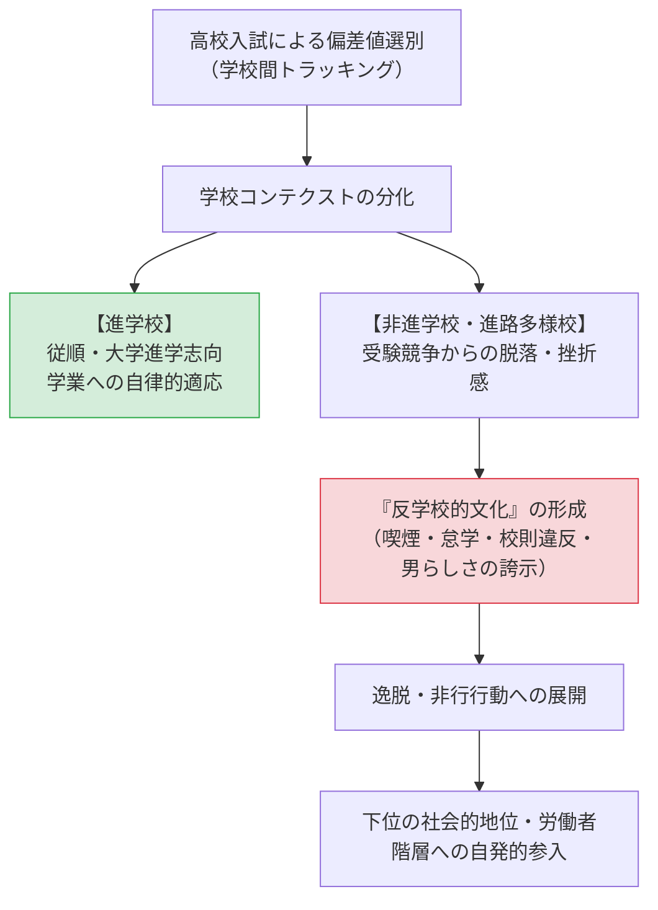

社会における教育の役割

授業で使用するスライドです。右下のボタンから全画面表示（Fキー）も可能です。

<!-- スライドの埋め込み部分 -->
<iframe class="slide-deck" src="Exclusion_Delinquency_slide.html" width="100%" height="450px" style="border: 1px solid #dee2e6; border-radius: 4px;"></iframe>

[🔗 スライドを別タブで大きく開く](Exclusion_Delinquency_slide.html){target="_blank"}

## 今日の目標

今回のテーマは、【生徒文化と学校問題：高校教育の階層構造と逸脱】

- 1）高校（後期中等教育）という学校段階が、小・中学校と異なり「インプット・スループット・アウトプット」のすべてにおいて高度に階層化・同質化されている特質を理解する
- 2）学校の序列ランク（学校コンテクスト）が生徒の意識や行動様式（生徒文化）をいかに規定し、反学校的文化や逸脱・非行を生み出すのかを理論的に説明できるようになる
- 3）消費社会化と学校改革が進む現代において、生徒文化がどのように変容し、「進路多様校」がどのような指導上のジレンマに直面しているのかを考察できるようになる

## 高校という学校段階の特異性

### イントロダクション：小中学校との決定的差異

私たちが経験してきた小学校や中学校は、学区制に基づく義務教育機関であり、学力や家庭環境、性格の異なる多様な子どもたちが一つの教室に混ざり合う「社会の縮図」であった。

これに対して、日本の高等学校（高校）は、高校入試（学力偏差値）という強力なスクリーニング装置を通じて、**生徒の選別と均質化が徹底される空間**である。

- **インプット（生徒層）の同質化｜** 高校受験によって、ほぼ同じ学力偏差値、似通った出身階層や進学意識を持つ生徒だけが集められる。
- **スループット（教育内容）の分化｜** 進学校では難関大受験のための高密度な講義が行われる一方、職業科や進路多様校では基礎的なリメディアル教育や就職指導、生活規律の指導が行われる。
- **アウトプット（進路）の分岐｜** 卒業後の進路（難関四大、一般四大、短期大学、専門学校、就職、無業者）が、学校のランクごとにあらかじめ一定の幅に水路づけられている。

まずは、各自が通った高校の進路環境を振り返ってみよう。

:::{.callout-important icon="false"}
## コメント(1)
あなたの出身高校（あるいは16〜18歳頃に通った学校）における、同学年の生徒の卒業後進路の内訳（大学・短大、専門学校、就職、その他など）は、それぞれ何割ずつくらいでしたか。だいたいの割合で構いませんので教えてください。（※皆さんの出身校の多様な背景を共有し、高校の特徴を思い起こすための問いです。）
:::

### 高校の制度的分類と実質的区分

現在、日本の中学校卒業者の98.9％が高等学校等へ進学する。制度上はほぼ全入の「準義務教育」でありながら、その内部は以下のように複雑に多層化されている。

- **1. 制度的分類（学科・課程）｜**
   - **学科区分：** 普通科（約73%）、専門学科（工業・商業・農業・水産・看護など、約21%）、総合学科（約5%）。
   - **修業形態：** 全日制、定時制（夜間・昼間）、通信制（近年、生徒数が急増）。
- **2. 実質的区分（進路実績による序列化）｜**
   - **進学校：** 卒業生のほぼ全員が四年制大学（難関大・中堅大）に進学する高校。
   - **進路多様校（非進学校）：** 大学進学、専門学校進学、就職など、生徒の卒業後進路が多岐にわたる高校。生徒間の学力差や学習意欲の開きが大きい。
   - **教育困難校：** 中途退学率が高く、授業の成立や生活規律の維持自体に多大なエネルギーが割かれる高校。

:::{.callout-important icon="false"}
## コメント(2)
日本やドイツでは、カリキュラムの違いや生徒の学力レベルの違いが学校「間」に見られる（高校受験やトラッキングで別々の学校に分かれる）のに対し、アメリカでは総合制高校（包括型）として同じ学校「内」のコース分けで見られるとされています。

もしあなたが文部科学大臣として、現代日本の高校教育制度を自由に再設計できるとしたら、学力レベルやカリキュラムの違いを「学校間」と「学校内」のどこにどのように設定しますか。その理由とともに述べてください。
:::

## 高校生と生徒文化：反学校的文化と逸脱の社会学

### 生徒文化（Student Culture）とは何か

社会学において、生徒集団の内部で自発的に形成され、共有されている共通の価値観、規範、行動様式、趣味・選好の体系を**「生徒文化（Student Culture）」**と呼ぶ。

学校が提示する公式のルール（校則、学習指導、道徳）に対し、生徒文化は必ずしも従順であるとは限らない。むしろ、学校の序列構造の底辺に置かれた生徒たちの中で、激しい反発や逸脱が生み出される。

### 学校コンテクストの決定力（耳塚 1980、苅谷 1986）

なぜ、生徒たちは非行や逸脱へと向かうのか。教育社会学では、個人の性格や家庭のせいにするのではなく、**「生徒がどのランクの高校に所属しているか（学校コンテクスト）」**が持つ強烈な影響力を明らかにしてきた。

- **耳塚寛明（1980）の知見｜**
   - 生徒の意識や生活態度を規定しているのは、本人の成績や個人の進路志望以上に、**「その学校が社会的にどう位置づけられているかという学校のタイプ（文脈）」**である。
   - 同じ程度の学力や志望を持っていても、進学校に入った生徒は「真面目に勉強する生徒文化」に巻き込まれ、非進学校に入った生徒は「勉強をバカにする生徒文化」に染まっていく。
- **予期的社会化と自己選抜（苅谷 1986）｜**
   - 中学生は高校入試の偏差値を通じて、自分が社会の中でどのランクに位置づけられるかを早期に思い知らされる。その結果、非進学校に進む生徒は入学前から「どうせ自分なんて」という諦め（自己選抜）を抱き、それが高校入学後の生徒文化として固定化される。

### ポール・ウィリス『ハマータウンの野郎ども』と反学校的文化

イギリスの社会学者ポール・ウィリス（Paul Willis 1977）は、労働者階級の男子生徒たち（「野郎ども（Lads）」）のエスノグラフィーを行い、教育社会学史上の古典的名著『ハマータウンの野郎ども』を著した。

- **反学校的文化（Anti-school Culture）の論理｜**
   - 学校が教える「真面目に勉強すれば出世できる」というメリトクラシーの教義を、野郎どもは欺瞞として見抜く。彼らは教師に反抗し、授業をサボり、校則を破り、タバコを吸い、酒を飲む。
   - 彼らは「従順に勉強する真面目な生徒（優等生＝耳野郎）」を「女々しい奴ら」と見下し、肉体的な強さ、ユーモア、連帯感といった**労働者階級特有の「男らしさ（マチズモ）」**を誇示することで自尊心を回復しようとする。
- **逆説的な階層再生産｜**
   - しかし皮肉なことに、学校の知的な価値を自ら投げ捨て、反抗を貫いた結果として、彼らは学校から資格や学歴を得られず、**「自ら進んで工場などの肉体労働者の地位へと向かう（自発的な階層の再生産）」**ことになってしまう。逸脱行動は、体制への反抗でありながら、支配体制を最も強固に固定化する装置として帰結するのである。

## 現代における生徒文化の変容と「進路多様校」の苦悩

### 学校化の衰退と消費社会の浸透（大多和 2014）

1990年代以降、日本の高校と生徒文化はさらなる変容を遂げている。

- **消費文化の影響力の増大｜**
   - アルバイトの普及、携帯電話・スマートフォンの浸透、ファストファッションなど、高校生が「学校の外側の消費空間」で自己同一性（アイデンティティ）や仲間関係を築くようになった。
   - かつてのように「学校に反抗する（ツッパリ・ヤンキー）」ことすらエネルギーの無駄とみなされ、学校に対しては「波風を立てず適当にやり過ごす」という**無気力・無関心（学校へのインボルブメントの低下）**が広がった（大多和 2014）。
- **「夢追い」型進路形成のジレンマ（荒川 2009）｜**
   - 総合学科やキャリア教育の導入により、「自分のやりたいこと・個性を探そう」という指導が推進された。しかし、確たる専門性や基礎学力がないまま「やりたいこと（自己表現・エンタメ・美容等）」を煽られた結果、生徒がフリーターや不安定就労、無認可の専門学校へと流出し、キャリアの梯子を踏み外すリスクが高まっている。

### 「進路多様校」における進路指導の現場リアリティ

大学進学者から就職者までが混在する進路多様校では、教員は極めて困難な舵取りを迫られている。

意欲や学力が著しく不足している生徒が、大学全入時代を背景に「何となく大学に行きたい」と希望した場合、教員は「本人の希望を尊重すべきか」、それとも「多額の学費や奨学金借金を背負って中退・フリーター化するリスクを避けるために就職や専門学校を勧めるべきか（冷却＝クーリング・アウト）」という深刻な板挟みに直面する。

:::{.callout-important icon="false"}
## コメント(3)
進路多様校が抱える指導上の課題を疑似体験してみましょう。

あなたはある進路多様校の高校3年生の担任教師だとします。生徒Aくんは、毎日登校はしているものの、授業中はほとんど寝ており、提出物も出さず、このままでは卒業単位の取得すら危ぶまれています。しかし、本人は「何となくみんなが行くから大学に進学したい（Fランク私大の総合型選抜を希望）」と言っており、5月に保護者を交えない二者面談を行うことになりました。

あなたはAくんに対して、この面談の場でどのような言葉をかけ、どのような進路指導・現実的なアドバイスを行いますか。具体的に記述してください。
:::

## 次回に向けて／今日の課題

次回からは、教育社会学の最終章である「教育制度と政策」へと進み、「組織としての学校と教師の労働」について分析します。

### 今回提出するもの

コメント（Canvas LMSより提出，1〜3は回答必須、以降は任意回答）

- **コメント(1)：** 出身高校における卒業後進路の内訳（大学・短大、専門学校、就職など）
- **コメント(2)：** 高校段階におけるカリキュラム・学力差の再設計案（学校間 vs 学校内）
- **コメント(3)：** 進路多様校の担任としての生徒Aくんへの進路指導シミュレーション

## 文献リスト

### 引用した文献（学術文献のみ）

- 荒川葉，2009，『「夢追い」型進路形成の功罪――高校改革の社会学』東信堂．
- 樋田大二郎・耳塚寛明・岩木秀夫・苅谷剛彦編著，2000，『高校生文化と進路形成の変容』学事出版．
- 伊藤秀樹，2017，『高等専修学校における適応と進路――後期中等教育のセーフティネット』東信堂．
- 苅谷剛彦，1986，「閉ざされた将来像――教育選抜の可視性と中学生の『自己選抜』」『教育社会学研究』41: 95-109．
- 耳塚寛明，1980，「生徒文化の分化に関する研究」『教育社会学研究』35: 111-122．
- 大多和直樹，2014，『高校生文化の社会学――生徒と学校の関係はどう変容したか』東信堂．
- Willis, Paul, 1977, *Learning to Labour: How Working Class Kids Get Working Class Jobs*, Saxon House.（＝熊沢誠・山田潤訳，1985，『ハマータウンの野郎ども――学校への反抗・労働への順応』ちくま学芸文庫．）

### 推奨文献

- 朝比奈なつ子，2002，『居場所としての高校――多様化する高校生の意識と生活』勁草書房．
- 中村高康，2018，『暴走する能力主義』ちくま新書．
