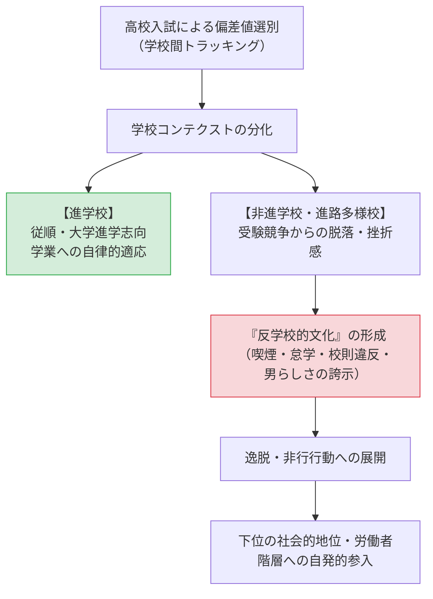

## 今日の目標

今回のテーマは、【生徒文化と学校問題：高校教育の階層構造と逸脱】

- 1）高校（後期中等教育）という学校段階が、小・中学校と異なり「インプット・スループット・アウトプット」のすべてにおいて高度に階層化・同質化されている特質を理解する
- 2）学校の序列ランク（学校コンテクスト）が生徒の意識や行動様式（生徒文化）をいかに規定し、反学校的文化や逸脱・非行を生み出すのかを理論的に説明できるようになる
- 3）消費社会化と学校改革が進む現代において、生徒文化がどのように変容し、「進路多様校」がどのような指導上のジレンマに直面しているのかを考察できるようになる

## 高校という学校段階の特異性：小中との差異{.scrollable}

- **小学校・中学校（義務教育・学区制）**
  - 多様な生徒が混ざり合う「社会の縮図」
- **高等学校（選抜と階層化）**
  - 入試（学力偏差値）により生徒と学校が峻別される
  - **インプット（生徒層）の同質化**：同じ偏差値・家庭背景の生徒が集約
  - **スループット（教育内容）の分化**：進学指導 vs 職業・生活規律指導
  - **アウトプット（進路）の分岐**：四大、専門、就職のレンジが学校別に固定

## コメント(1)

:::{.callout-important icon="false"}
## コメント(1)
あなたの出身高校（あるいは16〜18歳頃に通った学校）における、同学年の生徒の卒業後進路の内訳（大学・短大、専門学校、就職、その他など）は、それぞれ何割ずつくらいでしたか。だいたいの割合で構いませんので教えてください。（※皆さんの出身校の多様な背景を共有し、高校の特徴を思い起こすための問いです。）
:::

## 高校の分類と区分{.scrollable}

中学生の約99%が進学する「準義務教育」の中での多層化：

- **制度的分類（学科・課程）**
  - 普通科（約73%）、専門学科（約21%）、総合学科（約5%）
  - 全日制、定時制、通信制（生徒数が急増中）
- **実質的区分（進路実績による序列化）**
  - **進学校**：ほぼ全員が四年制大学（難関大・中堅大）に進学
  - **進路多様校**：大学、専門学校、就職など進路が多岐に分散
  - **教育困難校**：中退率が高く、授業成立や生活規律の維持に腐心

## コメント(2)

:::{.callout-important icon="false"}
## コメント(2)
日本やドイツでは、カリキュラムの違いや生徒の学力レベルの違いが学校「間」に見られる（高校受験やトラッキングで別々の学校に分かれる）のに対し、アメリカでは総合制高校（包括型）として同じ学校「内」のコース分けで見られるとされています。

もしあなたが文部科学大臣として、現代日本の高校教育制度を自由に再設計できるとしたら、学力レベルやカリキュラムの違いを「学校間」と「学校内」のどこにどのように設定しますか。その理由とともに述べてください。
:::

## 生徒文化と学校コンテクストの決定力{.scrollable}

- **生徒文化（Student Culture）**
  - 生徒集団の内部で共有される価値観、行動様式、趣味・選好
- **学校コンテクスト（文脈）の強い規定力（耳塚 1980）**
  - 生徒の意識や生活態度を規定するのは、個人の成績や志望以上に**「その学校が社会的にどう位置づけられているか（学校のランク）」**である
- **予期的社会化と自己選抜（苅谷 1986）**
  - 中学生は高校入試の偏差値によって自己の限界を悟り（自己選抜）、非進学校入学前から諦めの意識を内面化する

## 反学校的文化と逸脱の社会学{.scrollable}

P.ウィリス『ハマータウンの野郎ども』（1977）：

- 学校のメリトクラシー神話への反抗
- 勉強する生徒を「女々しい」と蔑み、肉体的な強さや仲間連帯（男らしさ）を誇示
- $\rightarrow$ **自ら学歴を放棄し、進んで肉体労働者の地位へ参入する（逆説的な階層再生産）**

## 現代の生徒文化と「進路多様校」の苦悩{.scrollable}

- **学校化の衰退と消費社会の浸透（大多和 2014）**
  - バイトやスマホ、SNSの普及により、学校の外側の消費空間にアイデンティティを確立
  - 反抗すらエネルギーの無駄とされ、「適当にやり過ごす」無気力・無関心が拡大
- **「夢追い」型進路指導の罠（荒川 2009）**
  - 基礎学力がないまま「やりたいこと（自己実現）」を煽られ、不安定就労や無認可専門学校へ流出
- **進路多様校における二者面談の板挟み**
  - 「大学全入時代だから大学に行きたい」という希望と、多額の学費借金・中退リスクの葛藤（クーリング・アウトの難しさ）

## コメント(3)

:::{.callout-important icon="false"}
## コメント(3)
進路多様校が抱える指導上の課題を疑似体験してみましょう。

あなたはある進路多様校の高校3年生の担任教師だとします。生徒Aくんは、毎日登校はしているものの、授業中はほとんど寝ており、提出物も出さず、このままでは卒業単位の取得すら危ぶまれています。しかし、本人は「何となくみんなが行くから大学に進学したい（Fランク私大の総合型選抜を希望）」と言っており、5月に保護者を交えない二者面談を行うことになりました。

あなたはAくんに対して、この面談の場でどのような言葉をかけ、どのような進路指導・現実的なアドバイスを行いますか。具体的に記述してください。
:::

## 今日の課題

### 今回提出するもの

- コメント（Canvas LMSより提出，1〜3は回答必須、以降は任意回答）
  - **コメント(1)：** 出身高校における卒業後進路の内訳（大学・短大、専門学校、就職など）
  - **コメント(2)：** 高校段階におけるカリキュラム・学力差の再設計案（学校間 vs 学校内）
  - **コメント(3)：** 進路多様校の担任としての生徒Aくんへの進路指導シミュレーション