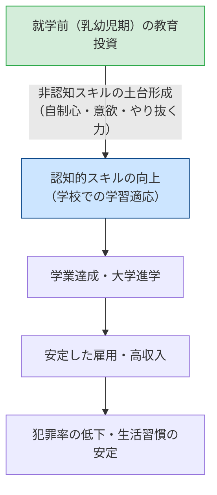

社会における教育の役割

授業で使用するスライドです。右下のボタンから全画面表示（Fキー）も可能です。

<!-- スライドの埋め込み部分 -->
<iframe class="slide-deck" src="Exclusion_Poverty_slide.html" width="100%" height="450px" style="border: 1px solid #dee2e6; border-radius: 4px;"></iframe>

[🔗 スライドを別タブで大きく開く](Exclusion_Poverty_slide.html){target="_blank"}

## 今日の目標

今回のテーマは、【家族の多様化と子どもの貧困：教育格差の深層】

- 1）1990年代以降の長期不況に伴う「戦後日本型循環モデル」の破綻と、家族構造の多様化（未婚化、少子化、ひとり親世帯の増加）を把握する
- 2）「相対的貧困」の定義と日本における「子どもの貧困」の実態、および親の経済力と教育戦略が学力を左右する「ペアレントクラシー」の構造を理解する
- 3）J.ヘックマンの研究に基づく「非認知スキル」と幼児教育の重要性を学び、平等化装置としての学校教育のあり方について批判的に議論できるようになる

## 日本社会の変容と家族のかたち

### イントロダクション

第3回で確認したように、高度経済成長期の日本社会は、「企業戦士として外で長時間働くサラリーマンの夫」と「家庭で家事・育児・教育を一手に引き受ける専業主婦の妻」、そして2人の子どもという核家族を「標準家族」として想定していた。

しかし、1990年代のバブル崩壊以降、このモデルを支えていた前提が大きく崩壊した。まずは、私たちの生活実感として「家族」のあり方がどのように変わったのかを振り返ってみよう。

:::{.callout-important icon="false"}
## コメント(1)
戦後日本型循環モデルがうまく機能していたとされる1980年頃と、皆さんが幼少期を過ごした2010年頃で、日本の「一般的な家族」に対する社会的なイメージはどのように変わったと思いますか。世帯の構成員や働き方、家庭内での役割分担など、どんな観点でも構いませんので、あなたの実感を簡潔に書いてみてください（※子育ての具体的なあり方はコメント②で扱うため除きます）。
:::

### 戦後日本型循環モデルの破綻と家族の多様化

教育社会学者の本田由紀（2014）が指摘するように、1990年代以降の「失われた30年」の中で、教育・仕事・家族の強固なトライアングルは目詰まりを起こし、破綻していった。

- **雇用の変容と「生活給」の解体｜**
   - 長期不況の中で企業は人件費を抑制し、非正規雇用（パート・アルバイト、派遣社員、契約社員など）が労働者全体の約4割を占めるまでに拡大した。
   - かつてのように「夫一人を雇えば、妻と子どもを養うに足る賃金（生活給）」を企業が保障するモデルが失われ、共働き世帯が専業主婦世帯の2倍以上へと急増した。
- **家族構造の多様化と脆弱化｜**
   - **生涯未婚率の急上昇：** 50歳時未婚率は男性で約28%、女性で約18%（2020年国勢調査）へと達し、「誰もが結婚して子どもを持つ」という前提が崩壊した。
   - **晩婚化と少子化の加速：** 平均初婚年齢は男女ともに30歳前後に達し、合計特殊出生率は1.20前後へと落ち込んでいる。
   - **ひとり親世帯の増加：** 離婚件数の高止まりにより、母子世帯を中心にひとり親世帯が増加した。

こうした変化により、かつては「標準的な家族」が自前で担っていた子どものケアや教育投資の能力に、世帯間で決定的な格差が生じることとなった。

:::{.callout-important icon="false"}
## コメント(2)
1980年頃の拡大家族や専業主婦家庭と、2010年頃の核家族や共働き・ひとり親家庭を比較したとき、日本社会における子育てや家庭教育のあり方はどのように変わったと思いますか。親の負担感や周囲からのサポート、教育方針など、あなたの考えを教えてください。
:::

## 子どもの貧困と「ペアレントクラシー」の罠

### 「子どもの貧困」の実態：見えない相対的貧困

日本は長年「一億総中流」社会と呼ばれ、絶対的な飢餓や極度の貧困とは無縁であると信じられてきた。しかし、2000年代以降、**「相対的貧困（Relative Poverty）」**の深刻な実態がデータによって可視化された。

- **相対的貧困の定義｜**
   - 世帯の可処分所得を世帯人員の平方根で割って調整した「等価可処分所得」の中央値の、半分（50%）に満たない所得水準に置かれている状態を指す。
   - 食べるものがないという「絶対的貧困」とは異なり、**「その社会の一般的な生活水準や文化的生活から排除され、通常の経験や教育機会を奪われている状態」**を意味する。
- **子どもの相対的貧困率｜**
   - 厚生労働省「国民生活基礎調査」によれば、日本の子どもの貧困率は**約11.5%〜14%前後（およそ7〜9人に1人）**で推移しており、OECD（経済協力開発機構）加盟国の中でも平均より悪い水準にある。
- **ひとり親世帯の極めて高い貧困率｜**
   - とくに深刻なのが「大人1人と子ども」の世帯（主に母子世帯）であり、その相対的貧困率は**約45〜50%**に達する。日本の女性労働者が直面する非正規雇用の多さや男女賃金格差、養育費の不払い問題が、子どもの貧困へと直接連鎖している。

### ペアレントクラシー（Parentocracy）の支配

新自由主義的な改革と自己責任論が浸透した現代社会において、教育のあり方はメリトクラシーから**「ペアレントクラシー（親主義）」**へと変容したと指摘される（Brown 1990）。

- **ペアレントクラシーの定義｜**
   - 子どもの将来の教育達成や社会的地位が、子ども自身の「能力や努力（メリトクラシー）」ではなく、**親の財力（富）や情報力、教育熱意・戦略（ペアレントクラシー）によって決定づけられる状態**。
- **「富＋願望＝学力」の定式（耳塚 2007）｜**
   - お茶の水女子大学の耳塚寛明らは、大規模な学力調査の分析から、家庭の「経済的ゆとり（富）」と、親が子どもに対して高い学歴を望む「教育期待（願望）」が結びついたとき、子どもの学力が最も高く引き上げられることを実証した。
   - 親が私立中学受験や早期教育、習い事のロードマップを戦略的に設計できる高所得層と、日々の生活費や労働に追われて教育に資源を割けない困窮層との間で、教育のスタートラインそのものが大きく乖離している。

## 幼児教育と「非認知スキル」：ヘックマンの発見

家庭環境による初期格差を是正するために、現代の教育経済学や教育社会学が最も注目しているのが**「幼児教育（就学前教育）」**と**「非認知スキル」**である。

### ペリー就学前プロジェクト（Perry Preschool Project）

ノーベル経済学賞受賞者のジェームズ・ヘックマン（James Heckman 2015）は、1960年代にアメリカ・ミシガン州で実施された「ペリー就学前プロジェクト」の40年にわたる追跡調査を計量経済学的に分析した。

- **実験の概要｜**
   - アフリカ系の貧困家庭の3〜4歳児をランダムに2群に分け、介入群にのみ質の高い就学前教育（毎日の少人数指導と週1回の家庭訪問）を2年間提供し、未介入群と比較した。
- **驚くべき長期的成果｜**
   - 就学直後には両群のIQの差は一時的に開いたものの、数年後にはIQの差は消滅した。
   - しかし、**40歳時点まで追跡した結果、就学前教育を受けたグループの方が、高校卒業率、大学進学率、月収、持ち家率が圧倒的に高く、逆に生活保護受給率や逮捕率は顕著に低かった**。
- **非認知スキル（社会情動的スキル）の再発見｜**
   - 就学前教育が育てたのは、単なる読み書き計算の「認知スキル」ではなく、**「自制心（我慢強さ）」「やり抜く力（Grit）」「協調性」「好奇心」「意欲」といった「非認知スキル（社会情動的スキル）」**であった。
   - 幼少期に育まれたこれらの非認知スキルが、その後の学校教育や社会生活での成功を支えるエンジンとして機能し続けたのである。

ヘックマンは、教育投資の収益率（社会的・私的リターン）は**子どもの年齢が低ければ低いほど高く、成人後の再教育よりも乳幼児期への公的投資こそが最も効率的な格差是正策である**と提言している。

## 平等化装置としての学校教育の可能性

家庭の経済力や文化資本が子どもの学力や非認知スキルを決定してしまう「ペアレントクラシー」に対抗しうる唯一の公的装置が、全国民が通う「公立学校教育」である。

しかし、第7回・第8回で見てきたように、現実の学校は「一律のカリキュラム」をこなすだけであり、家庭環境から持ち込まれる初期格差を十分に埋め合わせることができず、むしろその格差を「本人の実力差」として追認してしまうジレンマを抱えている。

貧困家庭の子どもたちに対し、学校は単なる教科指導にとどまらず、朝食の提供や放課後の学習支援、スクールソーシャルワーカーによる生活支援など、**「子どもの生活全体を支えるセーフティネット」としての機能をどこまで担うべきなのか**が問われている。

:::{.callout-important icon="false"}
## コメント(3)
あなたは、今後の日本社会においても、「家庭間の格差を埋め合わせる平等化装置」としての学校教育の役割を維持・強化していくべきだと思いますか。

- **そう思う人：** 制度面（予算・政策）や学校現場の実践面で、どのような改革を行えばその役割を果たせるか、具体策を提案してください。
- **そう思わない人：** 学校に過度な福祉・平等化の負担を負わせるべきではないと考える理由、あるいは学校以外のどのような仕組みで格差に対応すべきかを述べてください。
:::

## 次回に向けて／今日の課題

次回は、「排除と包摂・逸脱」の第2弾として、学校現場における「逸脱と非行」のメカニズムについて考察します。

### 今回提出するもの

コメント（Canvas LMSより提出，1〜3は回答必須、以降は任意回答）

- **コメント(1)：** 1980年頃と2010年頃における「一般的な家族」のイメージ変化
- **コメント(2)：** 拡大家族から核家族・共働き家庭への移行に伴う子育ての変化
- **コメント(3)：** 平等化装置としての学校教育の役割を維持すべきか否か（具体策または理由）

## 文献リスト

### 引用した文献（学術文献のみ）

- Brown, Phillip, 1990, "The 'Third Wave': Education and the Ideology of Parentocracy," *British Journal of Sociology of Education*, 11(1): 65-85.
- Heckman, James J., 2013, *Giving Kids a Fair Chance*, MIT Press.（＝古草秀子訳，2015，『幼児教育の経済学』東洋経済新報社．）
- 本田由紀，2014，『もじれる社会――戦後日本型循環モデルを超えて』ちくま新書．
- 岩間暁子・大和礼子・田間泰子，2015，『問いからはじめる家族社会学――多様化する家族の包摂に向けて』有斐閣．
- 耳塚寛明，2007，「小学校学力格差に挑む――だれが学力を獲得するのか」『教育社会学研究』80: 23-39．

### 推奨文献

- 本田由紀，2008，『「家庭教育」の隘路――子育てに強迫される母親たち』勁草書房．
- 阿部彩，2014，『子どもの貧困――日本の不公平を考える』岩波新書．
- 松岡亮二，2019，『教育格差――階層・地域・学歴』ちくま新書．
