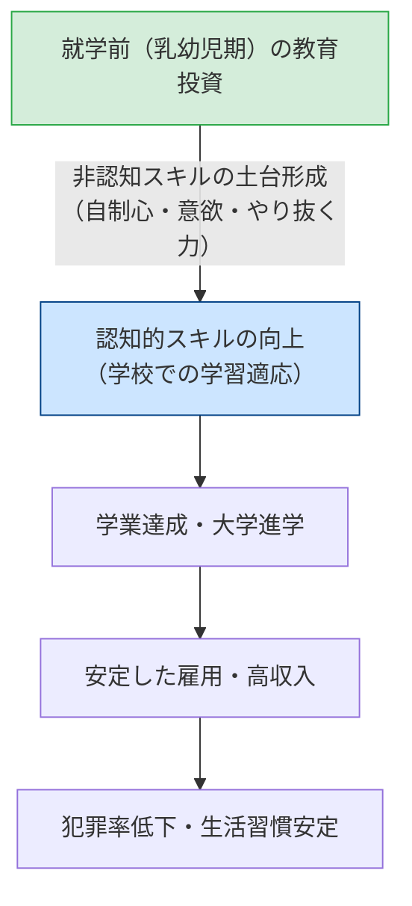

## 今日の目標

今回のテーマは、【家族の多様化と子どもの貧困：教育格差の深層】

- 1）1990年代以降の長期不況に伴う「戦後日本型循環モデル」の破綻と、家族構造の多様化（未婚化、少子化、ひとり親世帯の増加）を把握する
- 2）「相対的貧困」の定義と日本における「子どもの貧困」の実態、および親の経済力と教育戦略が学力を左右する「ペアレントクラシー」の構造を理解する
- 3）J.ヘックマンの研究に基づく「非認知スキル」と幼児教育の重要性を学び、平等化装置としての学校教育のあり方について批判的に議論できるようになる

## 日本社会の変容と家族：イントロダクション{.scrollable}

- **高度成長期の「標準家族」モデル**
  - サラリーマンの夫（稼ぎ手）＋専業主婦の妻（ケア・教育）＋子ども2人
- **1990年代以降の変容**
  - バブル崩壊、失われた30年、雇用の流動化・非正規化
  - 家族を支えていた前提が大きく崩壊

## コメント(1)

:::{.callout-important icon="false"}
## コメント(1)
戦後日本型循環モデルがうまく機能していたとされる1980年頃と、皆さんが幼少期を過ごした2010年頃で、日本の「一般的な家族」に対する社会的なイメージはどのように変わったと思いますか。世帯の構成員や働き方、家庭内での役割分担など、どんな観点でも構いませんので、あなたの実感を簡潔に書いてみてください（※子育ての具体的なあり方はコメント②で扱うため除きます）。
:::

## 戦後日本型循環モデルの破綻（本田 2014）{.scrollable}

- **雇用の変容と「生活給」の解体**
  - 非正規雇用が労働者の約4割へ拡大
  - 企業が「一家を養う賃金（生活給）」を保障するモデルが終焉
  - 共働き世帯が専業主婦世帯の2倍以上へ
- **家族構造の多様化と脆弱化**
  - **生涯未婚率の急上昇**（男性約28%、女性約18%）
  - **晩婚化・少子化**（合計特殊出生率1.20前後へ）
  - **ひとり親世帯の増加**（母子世帯の貧困リスク）
- $\rightarrow$ 家族が自前で子どもの教育費やケアを賄う能力に大きな格差

## コメント(2)

:::{.callout-important icon="false"}
## コメント(2)
1980年頃の拡大家族や専業主婦家庭と、2010年頃の核家族や共働き・ひとり親家庭を比較したとき、日本社会における子育てや家庭教育のあり方はどのように変わったと思いますか。親の負担感や周囲からのサポート、教育方針など、あなたの考えを教えてください。
:::

## 子どもの貧困：相対的貧困の実態{.scrollable}

- **相対的貧困（Relative Poverty）**
  - 等価可処分所得の中央値の50%未満の世帯
  - 飢餓ではなく、**「その社会の通常の生活水準や教育機会から排除されている状態」**
- **日本の子どもの貧困率**
  - **約11.5%〜14%（およそ7〜9人に1人）**
  - OECD加盟国の中でも平均より悪い水準
- **ひとり親世帯の深刻な貧困**
  - **母子世帯の貧困率は約45〜50%**
  - 女性の非正規雇用の多さ、男女賃金格差、養育費不払いが子どもへと連鎖

## ペアレントクラシー（Parentocracy）の支配{.scrollable}

- **P.ブラウン（1990）の概念提起**
  - 子どもの教育達成が、本人の能力や努力（メリトクラシー）ではなく、**親の財力（富）や情報力・教育戦略（ペアレントクラシー）で決まる状態**
- **「富＋願望＝学力」（耳塚 2007）**
  - 家庭の経済力と親の教育期待が合致したときに学力が最大化
  - 私立中受験や早期教育を戦略化できる層 vs 日々の生活に追われる層
  - スタートラインそのものの乖離

## 幼児教育と「非認知スキル」：ヘックマンの知見{.scrollable}

- **ペリー就学前プロジェクト（40年の追跡調査）**
  - 貧困層の幼児期に質の高い教育を受けた介入群は、40歳時点で**高学歴・高収入・高持ち家率・低逮捕率**を記録
- **非認知スキル（社会情動的スキル）**
  - 自制心、やり抜く力（Grit）、協調性、意欲がその後の学習と人生を牽引
  - **教育投資の収益率は年齢が低いほど高い（幼児教育の重要性）**

## コメント(3)

:::{.callout-important icon="false"}
## コメント(3)
あなたは、今後の日本社会においても、「家庭間の格差を埋め合わせる平等化装置」としての学校教育の役割を維持・強化していくべきだと思いますか。

- **そう思う人：** 制度面（予算・政策）や学校現場の実践面で、どのような改革を行えばその役割を果たせるか、具体策を提案してください。
- **そう思わない人：** 学校に過度な福祉・平等化の負担を負わせるべきではないと考える理由、あるいは学校以外のどのような仕組みで格差に対応すべきかを述べてください。
:::

## 今日の課題

### 今回提出するもの

- コメント（Canvas LMSより提出，1〜3は回答必須、以降は任意回答）
  - **コメント(1)：** 1980年頃と2010年頃における「一般的な家族」のイメージ変化
  - **コメント(2)：** 拡大家族から核家族・共働き家庭への移行に伴う子育ての変化
  - **コメント(3)：** 平等化装置としての学校教育の役割を維持すべきか否か（具体策または理由）