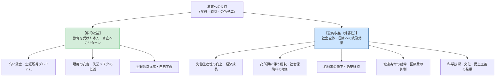

社会における教育の役割

授業で使用するスライドです。右下のボタンから全画面表示（Fキー）も可能です。

<!-- スライドの埋め込み部分 -->
<iframe class="slide-deck" src="Institution_Policy_slide.html" width="100%" height="450px" style="border: 1px solid #dee2e6; border-radius: 4px;"></iframe>

[🔗 スライドを別タブで大きく開く](Institution_Policy_slide.html){target="_blank"}

## 今日の目標

今回のテーマは、【教育の社会的役割と日本社会のゆくえ：エビデンスに基づく教育政策】

- 1）教育投資における「私的収益」と「公的収益（社会的収益・外部性）」の相違を理解し、日本の教育財政（特に高等教育への公的支出の少なさ）の国際的位置づけを把握する
- 2）日本社会が「教育劣位社会」に陥ってきた構造的背景（家族主義と世論の私的利害依存）と、客観的エビデンスの提示が世論を動かす可能性について理解する
- 3）EBPM（科学的根拠に基づく政策形成）の意義と限界を学び、半期の教育社会学の知見を踏まえて、個人の経験論を超えて教育と社会を洞察する「社会学的想像力」を総括する

## 教育への投資と収益を考える

### イントロダクション：子育てと教育の「コスト」

幼稚園や小学校から大学卒業に至るまで、親や社会は子どもの教育にどれほどの資源を投資しているのだろうか。私たちは日頃、教育を「文化」や「人格形成」として語りがちだが、経済学や社会学の視点から見ると、教育は極めて莫大なコストを伴う**「未来への投資行動」**でもある。

まずは、各自がこれまで受けてきた教育の費用について、具体的に概算してみよう。

:::{.callout-important icon="false"}
## コメント(1)
あなたの保護者（家族）は、あなたが生まれてから現在（大学在学中）に至るまでに、あなたにどれくらいのお金をかけてくれたでしょうか。以下の2点について、ざっくりとした概算で構いませんので金額を教えてください。

1. **学校関連費用：** 入学金・学費、受験料、塾・予備校代、教科書・制服代、通学定期代、部活費用など
2. **生活費を含めた総額：** 食費、住居費、衣料費、医療費、習い事、お小遣いなどを含む全費用
:::

### 教育投資の2つの果実：私的収益と公的収益

教育投資から得られるリターン（収益）は、投資した「本人（家族）」だけが享受するものではない。社会全体にも大きな波及効果をもたらす。

#### 1. 私的収益と私的収益率（個人への見返り）

- **大卒学歴の生涯プレミアム｜**
   - 妹尾・日下田（2011）の推計によれば、高校卒業者と大学卒業者の生涯賃金の差から、大学進学にかかった学費や4年間働かなかったことによる損失（機会費用）を差し引いた純利益は、**男子で約5,700万円、女子で約6,000万円**に達する。
   - これを年間の投資利回りに換算した「大学教育の私的収益率」は**年利約6〜8％**であり、株式投資や債券を大きく上回る極めて有望な投資先となっている。

#### 2. 公的収益と外部性（社会全体への見返り）

- **教育投資の「外部性（Externality）」｜**
   - ある個人の教育水準が高まることは、その本人だけでなく周囲の人々や国全体にプラスの影響を及ぼす。これを経済学で**「外部経済（ポジティブな外部性）」**と呼ぶ。
   - 高学歴・高技能の人材が増えれば、企業の生産性が向上してイノベーションが起き、国全体の経済成長と税収増加（所得税・消費税）がもたらされる。また、教育水準の向上は犯罪率の低下や生活習慣病の予防（健康リテラシー向上による医療費抑制）にもつながる。
- **公的支援の根拠｜**
   - 「本人が高給を得るためだけなら、学費は全額自己負担すべきだ」という意見がある。しかし、教育には莫大な「外部性（社会への見返り）」があるからこそ、国や社会が税金を投入して教育を無償化・低廉化する正当な根拠が存在するのである。

## 日本社会の現実：「教育劣位社会」の構造

### 国際比較からみた公教育費の貧困

OECD（経済協力開発機構）の年次報告書『Education at a Glance（図表でみる教育）』によれば、日本は世界有数の経済規模を誇りながら、**「教育に対する公的支出（対GDP比）」がOECD加盟国の中で長年最下位グループ（30数カ国中ほぼ最下位）**に低迷し続けている。

- **初等中等教育（小中高）の公私負担比率｜**
   - 義務教育を中心に一定の公費が投入されているものの、諸外国と比較すると依然として私費負担（保護者負担）の割合が高い。
- **高等教育（大学・短大・専門学校）の極端な私費依存｜**
   - 最も深刻なのが大学等の高等教育である。北欧諸国では大学授業料は完全無償であり、生活費給付型奨学金まで支給される。欧州大陸諸国でも年間数万円〜数十万円程度の登録料で済む。
   - これに対し日本は、学生の約8割が私立大学に通い、初年度130万円超の高額な授業料をほぼ家庭の私費負担に依存している。

### なぜ日本は「教育劣位社会」になったのか（矢野・濱中・小川 2016）

矢野眞和、濱中淳子、小川和孝ら（2016）は、実証的な世論調査の分析を通じて、日本社会が公的教育投資を軽視する**「教育劣位社会」**に陥ってきた病理を解明した。

1. **強固な「教育家族主義」の伝統｜**
   - 「子どもの教育費は親が責任を持って工面すべきだ」という自己責任論・家族主義が、国民意識の中に深く内面化されている。
2. **私的利害に縛られた世論形成｜**
   - 「増税してでも充実させるべき政策」を尋ねると、国民の関心は「医療」や「年金」「高齢者福祉」に圧倒的に集中し、「教育・子育て」への優先順位は極めて低い。
   - 人々は教育政策を「社会全体の投資」としてではなく、**「自分に大学進学期の子どもがいるかどうか（私的利害）」**という損得勘定で判断しがちである（子どもがいない層や子育てを終えた高齢層が反対に回る）。

### エビデンスの提示が世論を変える実験

矢野ら（2016）の研究における最大の希望ある知見は、**「客観的なエビデンス（教育の外部性に関するデータ）を情報提供すると、人々の態度が劇的に変わる」**という事実である。

- **実験結果｜**
   - 「大卒者が増えると税収が増え、社会保障を支える財源になる」「教育投資は国全体の生産性を高める」といった教育効果の外部性に関する客観的データを提示された回答者は、提示されなかった回答者に比べて、**「大学教育の費用を社会全体で負担すること」に対する賛成率が有意に跳ね上がった**。
- **含意｜**
   - 国民が教育無償化や公的投資に消極的だったのは、意地悪だからではなく、教育が社会全体にもたらす価値についての「客観的知識やエビデンス」が共有されてこなかったからにほかならない。

:::{.callout-important icon="false"}
## コメント(2)
矢野・濱中・小川（2016）の知見は、教育社会学的なデータやエビデンスを広く国民に伝えることで、「子育て世代 vs それ以外の世代」という私的利害の対立を超えて、教育への公的投資に対する世論の合意形成が可能であることを示しています。

もしあなたが、本講義で学んできたような「教育社会学的知識やデータ」を日本国民全体に広く普及させる責任者だとしたら、どのような手段やメディア、仕組みを用いて人々に情報を届けますか。具体的なアイデアを教えてください。

（例：SNSでのデータ可視化インフォグラフィックの発信、高校や大学での必須リテラシー教育、ふるさと納税のような教育寄付プラットフォームと効果の可視化など）
:::

## エビデンスに基づく教育議論（EBPM）と社会学的想像力

### 個人の経験論から「EBPM（Evidence-Based Policy Making）」へ

教育は、誰しもが一度は当事者として経験したことがあるがゆえに、政治家や評論家、一般市民に至るまで、**「私の頃はこうだった」「昔の教育の方が厳しくて良かった」「心の問題だ」といった個人的な主観やノスタルジー（経験論）で勝手気ままに語られやすい**という特異な性質を持っている（広田・伊藤 2010）。

しかし、個人の限られた経験を全体に一般化することは、偏見や誤った政策判断を招く最大の元凶である。現代の教育行政では、**EBPM（科学的根拠に基づく政策形成）**の重要性が強く叫ばれている。

- **EBPMの原則｜**
   - 政策の立案・実行にあたり、政策担当者の直感やイデオロギーではなく、「因果推論や計量分析に基づく客観的な実証データ（エビデンス）」に基づいて効果を検証し、意思決定を行う。
- **EBPMの注意点と限界｜**
   - テストの点数など「数値化しやすい指標」ばかりが優先され、人格形成や心のゆとりといった測定困難な教育の本質が見落とされるリスクがある。
   - 「何が効果的か（How）」をデータで示すことはできても、「教育は何を目指すべきか（What / Why）」という**価値の合意形成はデータだけでは決められない**。

### 半期の総括：教育を読み解く「社会学的想像力」

本講義「社会における教育の役割」を通じて、私たちが学んできたことの核心は、**「教育を、社会との構造的な関わりの中で捉え直す視点（社会学的想像力）」**である。

- 学力や進路の差を「個人の努力や能力の差」に帰するのではなく、その背後にある**家庭の経済・文化資本、ジェンダー規範、学校間トラッキング、地域の構造的格差**へと視野を広げること。
- 「当たり前」と信じ込まされてきた学校のルールや学歴主義、メリトクラシーの理念を、歴史的・社会的に作られたものとして相対化すること。

この批判的で冷静な視点こそが、将来皆さんが親として、職業人として、そして民主主義社会の一市民として、教育や社会政策に向き合う際の最も強固な羅針盤となるはずである。

:::{.callout-important icon="false"}
## コメント(3)
本講義（全14回）の全体を振り返って、以下の問いについてあなたの考えをまとめてください。

1. 本講義で学んだ教育社会学的な知見や視点の中で、**あなたの従来の教育観や常識を最も揺さぶった（印象に残った）テーマや概念**は何でしたか。理由とともに挙げてください。
2. そのような教育社会学のものの見方は、**今後のあなたの人生やキャリア、あるいは社会を見る眼差しにおいて、どのように役に立ちうる（あるいは役に立たない）**と考えますか。率直な自己評価を述べてください。
:::

## 今日の課題

### 今回提出するもの

コメント（Canvas LMSより提出，1〜3は回答必須、以降は任意回答）

- **コメント(1)：** これまで親から自分にかけられた教育費・生活費の概算
- **コメント(2)：** 教育社会学的エビデンスを国民全体に届けるためのアイデア
- **コメント(3)：** 講義全体の総括（最も印象に残ったテーマと、今後の人生・思考への活かし方）

## 文献リスト

### 引用した文献（学術文献のみ）

- 妹尾渉・日下田愛，2011，「大学教育の私的収益率とその推移――センサスデータによる再推計」『大学論集』42: 301-316．
- 矢野眞和・濱中淳子・小川和孝，2016，『教育劣位社会――教育費をめぐる世論の社会学』岩波書店．
- 広田照幸・伊藤茂樹編，2010，『教育問題はなぜまちがって語られるのか？――「わかったつもり」からの脱却』日本図書センター．
- OECD, 2021, *Education at a Glance 2021: OECD Indicators*, OECD Publishing.

### 推奨文献

- 矢野眞和，2001，『教育社会の設計』東京大学出版会．
- 中室牧子，2015，『「学力」の経済学』ディスカヴァー・トゥエンティワン．
- 苅谷剛彦，2008，『学力と階層――教育の不平等を問い直す』朝日文庫．
