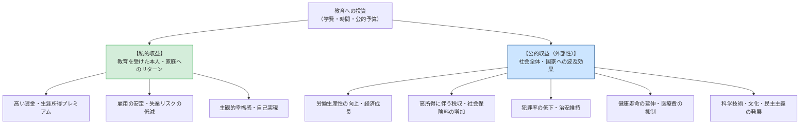

## 今日の目標

今回のテーマは、【教育の社会的役割と日本社会のゆくえ：エビデンスに基づく教育政策】

- 1）教育投資における「私的収益」と「公的収益（社会的収益・外部性）」の相違を理解し、日本の教育財政（特に高等教育への公的支出の少なさ）の国際的位置づけを把握する
- 2）日本社会が「教育劣位社会」に陥ってきた構造的背景（家族主義と世論の私的利害依存）と、客観的エビデンスの提示が世論を動かす可能性について理解する
- 3）EBPM（科学的根拠に基づく政策形成）の意義と限界を学び、半期の教育社会学の知見を踏まえて、個人の経験論を超えて教育と社会を洞察する「社会学的想像力」を総括する

## 教育への投資と収益：イントロダクション{.scrollable}

- **教育は「未来への投資」**
  - 文化や人格形成であると同時に、莫大なコストとリターンを伴う投資行動
- **問い**
  - これまで私たちは、親や社会からどれほどの教育投資を受け取ってきたのか？

## コメント(1)

:::{.callout-important icon="false"}
## コメント(1)
あなたの保護者（家族）は、あなたが生まれてから現在（大学在学中）に至るまでに、あなたにどれくらいのお金をかけてくれたでしょうか。以下の2点について、ざっくりとした概算で構いませんので金額を教えてください。

1. **学校関連費用：** 入学金・学費、受験料、塾・予備校代、教科書・制服代、通学定期代、部活費用など
2. **生活費を含めた総額：** 食費、住居費、衣料費、医療費、習い事、お小遣いなどを含む全費用
:::

## 教育投資の2つの果実：私的収益と公的収益{.scrollable}

## 私的収益 vs 公的収益（外部性）{.scrollable}

- **私的収益率の高さ（個人へのリターン）**
  - 大卒の生涯所得プレミアムから学費・機会費用を引いた純利益：
    - **男子：約5,700万円** ／ **女子：約6,000万円**
  - 年間利回り換算（私的収益率）は**約6〜8％**（妹尾・日下田 2011）
- **教育投資の外部性（社会へのリターン）**
  - 高学歴人材の増加 $\rightarrow$ イノベーション、生産性向上、税収増
  - 犯罪率低下、健康水準向上による医療費抑制
  - $\rightarrow$ **教育には莫大な外部性があるからこそ、国が公費を投入して無償化・低廉化する正当性がある**

## 日本の現実：「教育劣位社会」の構造{.scrollable}

- **公的教育支出の国際的立ち位置（OECD調査）**
  - 対GDP比の公的教育支出は**OECD加盟国中で長年最下位グループ**
  - とくに高等教育（大学等）の公費支出が著しく低く、**初年度130万円超の授業料を家庭の私費負担に依存**
- **なぜ日本は「教育劣位社会」になったのか（矢野ら 2016）**
  1. **強固な「教育家族主義」**：「子どもの教育費は親が賄うのが当然」という規範
  2. **私的利害に縛られた世論**：増税の使途として「年金・医療」が圧倒的で、教育の優先度は極めて低い。「子どものいる現役層 vs いない層・高齢層」の対立

## エビデンスが世論を変える実験（矢野ら 2016）{.scrollable}

- **情報提供実験の結果**
  - 「大卒者が増えると税収が増えて社会保障を支える」「国全体の生産性が高まる」という**教育の外部性の客観的データを提示**
  - $\rightarrow$ **「大学費用を社会全体で負担すべき」という賛成率が有意に跳ね上がった**
- **示唆**
  - 国民が公的支援に消極的だったのは、教育の社会的価値に関する**「客観的エビデンス」が共有されてこなかったため**

## コメント(2)

:::{.callout-important icon="false"}
## コメント(2)
矢野・濱中・小川（2016）の知見は、教育社会学的なデータやエビデンスを広く国民に伝えることで、「子育て世代 vs それ以外の世代」という私的利害の対立を超えて、教育への公的投資に対する世論の合意形成が可能であることを示しています。

もしあなたが、本講義で学んできたような「教育社会学的知識やデータ」を日本国民全体に広く普及させる責任者だとしたら、どのような手段やメディア、仕組みを用いて人々に情報を届けますか。具体的なアイデアを教えてください。

（例：SNSでのデータ可視化インフォグラフィックの発信、高校や大学での必須リテラシー教育、ふるさと納税のような教育寄付プラットフォームと効果の可視化など）
:::

## EBPMと社会学的想像力：半期の総括{.scrollable}

- **個人の経験論から「EBPM（科学的根拠に基づく政策形成）」へ**
  - 「自分の時代はこうだった」「昔の教育が良かった」という主観・ノスタルジーによる教育論議からの脱却
  - 客観的データと因果推論に基づく検証（※数値化できる指標への偏重には注意）
- **教育を読み解く「社会学的想像力」**
  - 個人の学力や進路を「努力・能力」だけに帰するのではなく、**家庭の階層、ジェンダー、学校トラッキング、地域の構造**へと目を向ける
  - 当たり前とされる学校のルールや学歴主義を歴史的・社会的に相対化する批判的視点を

## コメント(3)：半期の振り返り

:::{.callout-important icon="false"}
## コメント(3)
本講義（全14回）の全体を振り返って、以下の問いについてあなたの考えをまとめてください。

1. 本講義で学んだ教育社会学的な知見や視点の中で、**あなたの従来の教育観や常識を最も揺さぶった（印象に残った）テーマや概念**は何でしたか。理由とともに挙げてください。
2. そのような教育社会学のものの見方は、**今後のあなたの人生やキャリア、あるいは社会を見る眼差しにおいて、どのように役に立ちうる（あるいは役に立たない）**と考えますか。率直な自己評価を述べてください。
:::

## 今日の課題

### 今回提出するもの

- コメント（Canvas LMSより提出，1〜3は回答必須、以降は任意回答）
  - **コメント(1)：** これまで親から自分にかけられた教育費・生活費の概算
  - **コメント(2)：** 教育社会学的エビデンスを国民全体に届けるためのアイデア
  - **コメント(3)：** 講義全体の総括（最も印象に残ったテーマと、今後の人生・思考への活かし方）
