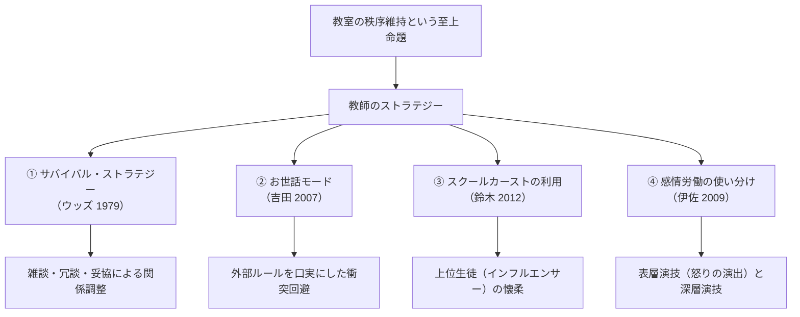

社会における教育の役割

授業で使用するスライドです。右下のボタンから全画面表示（Fキー）も可能です。

<!-- スライドの埋め込み部分 -->
<iframe class="slide-deck" src="Institution_Teacher_slide.html" width="100%" height="450px" style="border: 1px solid #dee2e6; border-radius: 4px;"></iframe>

[🔗 スライドを別タブで大きく開く](Institution_Teacher_slide.html){target="_blank"}

## 今日の目標

今回のテーマは、【教師の役割と教育労働：指導・ストラテジー・多忙化】

- 1）近代学校における「指導の文化」と、教師が生徒の全人格に対して持ちうる「権力」の構造を理解する
- 2）学級の秩序を維持するために教師が駆使する「サバイバル・ストラテジー」や「感情労働」のメカニズムを説明できるようになる
- 3）現代の日本社会で深刻化している「教師の多忙化」とバーンアウト（燃え尽き症候群）の制度的要因（給特法や無限定な職務範囲）について批判的に議論できるようになる

## 教師の権力と「指導」の文化

### イントロダクション：教師の持つ「権力」とは何か

学校において、教師は生徒にとってどのような存在だろうか。「教科の知識を教えてくれる人」であると同時に、服装や髪型をチェックし、教室での私語を注意し、友人関係のトラブルに介入し、進路を査定する存在でもある。

まずは、私たちが受けてきた学校教育の日常を振り返り、教師と生徒の間にある「権力関係」について考えてみよう。

:::{.callout-important icon="false"}
## コメント(1)
中学校や高校において、教師はどのような場面で、生徒に対して「権力（生徒の行動や身体、思考に対する強制力・決定権）」を持ちうるでしょうか。あなたが実際に経験したり見聞きしたりした具体例を1つ挙げ、どのような強制力が働いていたかを説明してください。

（例：朝の校門で服装・頭髪や持ち物を厳格にチェックし、違反者に反省文や居残りを課す、など）
:::

### 「学級」の成立と「全人格的指導」の誕生

近代的な学級制度が確立する以前の教育（江戸時代の寺子屋や藩校、ヨーロッパのギルド的徒弟制など）では、教師の役割は主に「学問や技術の教授」に限定されていた。教師は学びの仲間における先達であり、子どもの全人格的な生活規律まで管理する存在ではなかった。

しかし、近代国家が一斉教授方式と学級制を導入したことで、教室は**「一人の教師が数十人の生徒の身体と視線を一望・監視する権力空間」**へと変貌した。

- **「指導」という名の介入（酒井 2014）｜**
   - 日本の学校教育には、教科学習にとどまらず、掃除、給食、登下校、服装・身だしなみ、礼儀作法、さらには生徒の「心構えや感情（反省の態度）」に至るまで、生活のあらゆる局面に教育的意味を与えて介入する**「指導の文化」**が深く根ざしている。
   - 酒井朗（2014）は、「指導とは、教師が行う各種の活動に教育的正当性を与えて一括りに定義するための教育言説である」と指摘する。
- **全人格的権力の両義性｜**
   - 生徒の生活全般を温かく見守る「ケア」としての側面を持つ反面、生徒のプライバシーや身体的自己決定権を一方的に侵害しうる強大な権力装置となる。
   - 同時に、この「全人格的指導」の文化は、教師に対して「生徒の非行やトラブル、心のケアまで、すべて教師の責任である」という**無限定な職務責任（無限責任）**を負わせる元凶ともなっている。

## 秩序維持と教師のストラテジー（戦略）

学級という閉鎖空間において、一人の大人が40人前後の子どもたちを毎日統制し、授業を成立させることは決して容易ではない。教師は生き延びるために、様々な教育社会学的**「ストラテジー（戦略）」**を駆使している。

### 1. サバイバル・ストラテジー（Woods 1979）

イギリスの社会学者ピーター・ウッズ（Peter Woods）は、教師が教室崩壊を避け、自らの尊厳と秩序を守るための日常的戦術を**「サバイバル・ストラテジー」**と呼んだ。

- 授業中に流行りのテレビ番組やSNSの話題を振って生徒の歓心を買う。
- 厳しい指導ばかりではなく、あえて一部の私語を見逃すことで生徒との「暗黙の休戦協定（妥協）」を結ぶ。
- ユーモアや自虐ネタで教室の緊張を緩和する。

### 2. 「お世話モード」による衝突回避（吉田 2007）

教育困難校の生徒指導を分析した吉田美穂（2007）は、現代の教師が力づくの説教を避け、**「お世話モード」**と呼ばれる柔らかな統制システムを用いていることを明らかにした。

- 生徒と真っ向から価値観で対立・衝突するのを避け、「私は怒っているわけじゃないよ、あなたの将来のために言っているんだよ」という受容的な態度をとる。
- 「校則で決まっているから」「教育委員会の決まりだから」と外部の客観的ルールを口実にすることで、教師個人への反発を巧みに回避する。

### 3. スクールカーストの利用（鈴木 2012）

鈴木翔（2012）が指摘するように、現代の教室には生徒間の人気やコミュ力に基づく目に見えない序列（スクールカースト）が存在する。

経験豊富な教師は、カースト上位の生徒（クラスのインフルエンサー）を味方につけたり、行事のリーダーに指名したりすることで、彼らを通じてクラス全体の空気を動かし、間接的に学級の秩序をコントロールする戦略をとることがある。

### 4. 教師の「感情労働」：表層演技と深層演技（伊佐 2009）

社会学者A.R.ホックシールドが提唱した**「感情労働（Emotional Labor）」**は、現代の教職を理解する上で不可欠な概念である。

教師は単に肉体や知能を使うだけでなく、自らの感情を職業規範に合わせて高度にコントロールすることが求められる。伊佐夏実（2009）によれば、教師は以下の2つの演技を戦略的に使い分けている。

- **表層演技（Surface Acting）｜** 心の中では動揺したり冷静だったりしても、教育的効果を狙って「わざと怒った表情を作る」「意図的なため息をつく」「作り笑いで安心させる」など、外見の感情表出を操作する。
- **深層演技（Deep Acting）｜** 「この子の反抗は成長の証なのだ」「自分がイライラしてはいけない」と自らの内面や認知そのものに働きかけ、心から慈愛や冷静さを感じようと自己を自己規律化する。

こうした感情労働の過剰な蓄積は、教師の心身を徐々にすり減らし、深刻なバーンアウト（燃え尽き）の引き金となる。

:::{.callout-important icon="false"}
## コメント(2)
あなたが、中学校1年生の「やや落ち着きがなく、私語が多くてにぎやかなクラス」の担任になったとします。

学級崩壊を防ぎ、生徒たちと信頼関係を築きながら1年間安定して学級を運営していくために、あなたはどのように“戦略的に”生徒たちに接しますか。本講義で紹介したストラテジー（サバイバル・ストラテジー、お世話モード、感情労働など）を応用しても、あなた独自のアイデアでも構いませんので、具体的に述べてください。
:::

## 教職の多忙化と教育労働の病理

### 深刻化する長時間労働の実態

文部科学省の「教員勤務実態調査（令和4年度速報値）」によれば、日本の公立学校教員の時間外勤務（学内勤務時間＋持ち帰り残業）は極めて深刻な水準にある。

- **中学校教諭の勤務実態｜**
   - 1日あたりの学内勤務時間は平均**約11時間**に及び、週当たりの労働時間は**57.5時間**に達する。これは一般企業のフルタイム労働者（週約38〜40時間）を大幅に超過している。
   - いわゆる「過労死ライン」（月80時間の時間外労働）を超える教員が、中学校で約37%、小学校で約14%に上る。
- **業務内容別の負担｜**
   - 授業（本来の業務）の時間は小学校で1日約3時間50分、中学校で約2時間50分にすぎない。
   - 残りの膨大な時間は、授業準備、テストの採点、児童生徒指導、保護者対応、事務書類作成、職員会議、そして中学校における**「部活動指導（土日の引率・審判）」**に費やされている。

### 多忙化の制度的元凶：給特法という「定額働かせ放題」システム

民間企業であれば、労働基準法第37条に基づき、残業時間に応じた「割増賃金（残業代）」を支払わなければならない。しかし、公立学校の教員には、1971年に制定された**「給特法（公立義務教育諸学校等の教育職員の給与等に関する特別措置法）」**が適用されている。

- **給特法の仕組み｜**
   - 教員には原則として**「時間外勤務手当（残業代）」を支給しない**。
   - その代わりに、月給の**「4％」**を一律に「教職調整額」として上乗せ支給する。
   - 制度上、校長が命じることができる時間外勤務は「超4項目（校外実習・実地指導、修学旅行等学校行事、職員会議、非常災害時の緊急対応）」に厳格に限定されている。
- **制度疲労と「残業代ゼロ」の弊害｜**
   - 制定当初（1960年代）の教員の残業時間は月平均8時間程度であったため、「月給の4%」は妥当とされていた。
   - しかし現在、教員の月残業時間は80〜100時間前後に達している。それにもかかわらず、行政や管理職にとっては**「どれだけ教員を長時間残業させても人件費が1円も増えない（予算制約が働かない）」**ため、業務削減への強いインセンティブが働かず、「定額働かせ放題の温床」として批判を浴び続けている。
   - （※2024〜2025年にかけて、教職調整額を4%から10%以上に引き上げる法改正案や、業務削減のガイドライン策定が激しく議論されている。）

### 多忙化の本質的要因：〈かかわりあい〉の無限定性（油布 2010）

教育社会学者の油布佐和子（2010）は、教職の多忙化が単なる「仕事の量の多さ」ではなく、**教育労働特有の質的構造**に起因していると指摘する。

1. **〈かかわりあい〉としての労働の無限定性｜**
   - 「どこまでやれば十分か」という明確なゴールがない。放課後の補習、生徒の悩み相談、不登校児童の家庭訪問など、やろうと思えば無限に仕事を増やせてしまう。
2. **教師の使命感と「やりがい搾取」｜**
   - 教師自身が「子どものため」という崇高な使命感を持っているため、過酷な労働環境であっても自らを追い込む形で自発的に引き受けてしまう。
3. **同僚性（中間集団）の解体と孤立｜**
   - 職員室の多忙化や管理統制の強化により、同僚教員同士が気軽に悩みを相談し合い、助け合う「協働のゆとり」が失われ、各教員が教室で孤立している。

:::{.callout-important icon="false"}
## コメント(3)
文部科学省の教員勤務実態調査によれば、中学校教員の勤務時間は週57.5時間に達し、過労死ラインを超える教員が後を絶ちません。教員のなり手不足（教員採用試験の倍率低下）も深刻化しています。

あなたは、教師の過酷な多忙化を解消し、持続可能な学校教育を実現するために、国や社会はどのような改革を最優先で行うべきだと考えますか。「給特法や給与制度」「部活動の地域移行」「業務の削減・分業（チーム学校）」「保護者・地域の意識改革」など、あなたの考えを理由とともに述べてください。
:::

## 次回に向けて／今日の課題

次回は、本講義の最終回として「教育政策とエビデンス」を取り上げ、データやエビデンスに基づく教育政策（EBPM）の可能性と限界について議論します。

### 今回提出するもの

コメント（Canvas LMSより提出，1〜3は回答必須、以降は任意回答）

- **コメント(1)：** 中学校・高校で教師が生徒に「権力」を持ちうる場面の具体例
- **コメント(2)：** 中1の落ち着きのないクラス担任としての戦略的アプローチ
- **コメント(3)：** 教師の多忙化を解消するための最優先改革案

## 文献リスト

### 引用した文献（学術文献のみ）

- 伊佐夏実，2009，「教師ストラテジーとしての感情労働」『教育社会学研究』84: 125-144．
- 酒井朗，2014，『教育臨床社会学の可能性』勁草書房．
- 鈴木翔，2012，『教室内カースト』光文社新書．
- 吉田美穂，2007，「『お世話モード』と『ぶつからない』統制システム――アカウンタビリティを背景とした『教育困難校』の生徒指導」『教育社会学研究』81: 89-109．
- 油布佐和子，2010，「教職の病理現象にどう向き合うか――教育労働論の構築に向けて」『教育社会学研究』86: 23-38．
- Woods, Peter, 1979, *The Divided School*, London: Routledge & Kegan Paul.

### 推奨文献

- 朝倉景樹，2002，『登校拒否のエスノグラフィー』青弓社．
- 妹尾昌俊，2019，『教師崩壊――教育現場の黒い真実』PHP新書．
- 文部科学省，2023，『教員勤務実態調査（令和4年度）の集計（速報値）について』．
