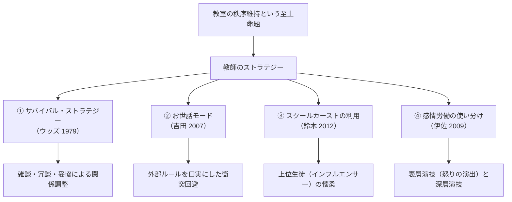

## 今日の目標

今回のテーマは、【教師の役割と教育労働：指導・ストラテジー・多忙化】

- 1）近代学校における「指導の文化」と、教師が生徒の全人格に対して持ちうる「権力」の構造を理解する
- 2）学級の秩序を維持するために教師が駆使する「サバイバル・ストラテジー」や「感情労働」のメカニズムを説明できるようになる
- 3）現代の日本社会で深刻化している「教師の多忙化」とバーンアウト（燃え尽き症候群）の制度的要因（給特法や無限定な職務範囲）について批判的に議論できるようになる

## 教師の権力と「指導」：イントロダクション{.scrollable}

- **教師とはどんな存在か**
  - 単に「教科知識を教える人」にとどまらない
  - 服装や髪型をチェックし、私語を注意し、友人関係に介入し、反省を迫る存在
- **教師と生徒の権力関係**
  - 学校という空間において、教師はどのような正当性に基づいて生徒に強制力を及ぼしているのか？

## コメント(1)

:::{.callout-important icon="false"}
## コメント(1)
中学校や高校において、教師はどのような場面で、生徒に対して「権力（生徒の行動や身体、思考に対する強制力・決定権）」を持ちうるでしょうか。あなたが実際に経験したり見聞きしたりした具体例を1つ挙げ、どのような強制力が働いていたかを説明してください。

（例：朝の校門で服装・頭髪や持ち物を厳格にチェックし、違反者に反省文や居残りを課す、など）
:::

## 「学級」の成立と「指導」の文化{.scrollable}

- **近代以前の教育**
  - 寺子屋やギルド：教師は「学問や技術の先達」
  - 生徒の私生活や全人格まで管理・指導する存在ではなかった
- **近代の一斉教授と学級制の導入**
  - 教室は**「一人の教師が数十人の身体・視線を一望・監視する権力空間」**へ
- **日本特有の「指導」の文化（酒井 2014）**
  - 掃除、給食、登下校、服装、言葉遣い、反省の態度まで、生活の全領域に教育的意味を与えて介入
  - **両義性**：温かい「全人的ケア」であると同時に、生徒の自己決定権を侵す権力となり、教師には**「無限責任」の過重負担**をもたらす

## 教師のストラテジー（生存戦略）{.scrollable}

閉鎖された教室で40人を統制し、生き延びるための教育社会学的戦略：

## ストラテジーの具体例と「感情労働」{.scrollable}

- **サバイバル・ストラテジー（Woods 1979）**
  - 流行の話題を振る、ユーモア、一部の私語を見逃す妥協
- **お世話モード（吉田 2007）**
  - 正面衝突を避け、「あなたの将来のため」「校則で決まっているから」と受容的に包摂
- **スクールカーストの利用（鈴木 2012）**
  - カースト上位生徒（人気者）を味方につけてクラスの空気を誘導
- **教師の「感情労働」（伊佐 2009）**
  - **表層演技**：わざと怒った顔をする、計算されたため息、作り笑い
  - **深層演技**：「この子の成長のため」と自己の内面感情を自己規律化
  - $\rightarrow$ 過剰な感情コントロールがバーンアウト（燃え尽き）を招く

## コメント(2)

:::{.callout-important icon="false"}
## コメント(2)
あなたが、中学校1年生の「やや落ち着きがなく、私語が多くてにぎやかなクラス」の担任になったとします。

学級崩壊を防ぎ、生徒たちと信頼関係を築きながら1年間安定して学級を運営していくために、あなたはどのように“戦略的に”生徒たちに接しますか。本講義で紹介したストラテジー（サバイバル・ストラテジー、お世話モード、感情労働など）を応用しても、あなた独自のアイデアでも構いませんので、具体的に述べてください。
:::

## 教職の多忙化：勤務実態調査の衝撃{.scrollable}

文部科学省「教員勤務実態調査（令和4年度）」のデータ：

- **過酷な労働時間**
  - 中学校教諭の週当たり労働時間は平均**57.5時間**（一般フルタイムは週約38〜40時間）
  - **過労死ライン（月80時間超の時間外労働）を超える教員が中学校で約37%、小学校で約14%**
- **授業以外の膨大な業務負担**
  - 授業時間は小学校で約3時間50分、中学校で約2時間50分にすぎない
  - 授業準備、採点、生活指導、保護者対応、事務書類、職員会議、そして中学校の**「土日・放課後の部活動指導」**

## 多忙化の制度的元凶：給特法システム{.scrollable}

- **給特法（1971年制定）の構造**
  - 教員には原則として**「時間外手当（残業代）」を一切支給しない**
  - 代わりに月給の**「4％」**を一律に「教職調整額」として上乗せ
  - 労基法第37条の適用除外
- **「定額働かせ放題」という批判**
  - 制定時（昭和40年代）の残業は月平均8時間 $\rightarrow$ 現在は月80〜100時間
  - **行政や管理職にとって、どれだけ長時間働かせても人件費が1円も増えない（予算制約が働かない）**ため、業務削減へのインセンティブが機能しない
  - （※現在、調整額を10%へ引き上げる法改正や業務見直しが議論中）

## 多忙化の本質的要因：〈かかわりあい〉の病理{.scrollable}

油布佐和子（2010）による教育労働論：

1. **〈かかわりあい〉としての労働の無限定性**
   - 「どこまでやれば終わり」というゴールがない
   - 補習、悩み相談、家庭訪問など、やろうと思えば無限に増殖する
2. **使命感と「やりがい搾取」**
   - 教員自身の「子どものため」という献身が、過酷な労働を自発的に引き受けてしまう罠
3. **同僚性（職員室の支え合い）の解体**
   - 管理強化と多忙により、同僚に相談できず孤立してメンタルを病む

## コメント(3)

:::{.callout-important icon="false"}
## コメント(3)
文部科学省の教員勤務実態調査によれば、中学校教員の勤務時間は週57.5時間に達し、過労死ラインを超える教員が後を絶ちません。教員のなり手不足（教員採用試験の倍率低下）も深刻化しています。

あなたは、教師の過酷な多忙化を解消し、持続可能な学校教育を実現するために、国や社会はどのような改革を最優先で行うべきだと考えますか。「給特法や給与制度」「部活動の地域移行」「業務の削減・分業（チーム学校）」「保護者・地域の意識改革」など、あなたの考えを理由とともに述べてください。
:::

## 今日の課題

### 今回提出するもの

- コメント（Canvas LMSより提出，1〜3は回答必須、以降は任意回答）
  - **コメント(1)：** 中学校・高校で教師が生徒に「権力」を持ちうる場面の具体例
  - **コメント(2)：** 中1の落ち着きのないクラス担任としての戦略的アプローチ
  - **コメント(3)：** 教師の多忙化を解消するための最優先改革案
