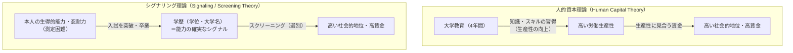

## 今日の目標

今回のテーマは、**入試と選抜、学歴社会論と就職**（「人が選ばれる」ことと「人が人を選ぶ」こと）

- 1）日本の入試制度（一発勝負のペーパーテスト、入試改革の振り子、加熱と冷却、高校間トラッキング、統制機能）が、単なる学力測定を超えて社会秩序の維持や動機づけに果たす役割を説明できるようになる
- 2）学歴・資格が社会的地位に結びつくメカニズムについて、人的資本理論・シグナリング理論に加え、コリンズの「資格社会」論（葛藤理論）や学歴の「形式的側面」に着目する諸理論を比較して理解する
- 3）学校から職業への移行（トランジション）における「日本的雇用慣行」（新卒一括採用、メンバーシップ型、遅い昇進）の特質や、大学大衆化に伴うEMI仮説・ハイパー・メリトクラシーといった現代の学歴社会の変容を批判的に議論できるようになる

## 入試と形式的公平性のイリュージョン{.scrollable}

今回は**「人が選ばれる」**ことと**「人が人を選ぶ」**ことの両面を扱う。前半はまず「入試」という社会装置に注目する。

- **儀式としての入試**
  - 特定の期日に同条件で一斉にペーパーテストを受け、点数で明瞭に合否が出る環境は、「フェアな競争に参加している」という強い納得感（**形式的公平性**）を与える
- **隠された属性選抜**
  - 1点刻みで公正に見える学力入試だが、難易度の高い選抜になるほど、合格者に占める「親が大卒」「通塾経験あり」の割合が跳ね上がる
  - ペーパーテストは「家庭環境の格差」を客観的で正当な「個人の能力差」へと偽装・変換して選抜する装置として機能している

## 入試改革の「振り子」と政治的機能{.scrollable}

- **「ペーパーテスト本位」と「人物重視」の揺れ動き**
  - 「点数偏重の一発勝負」への批判と、「調査書・推薦・面接による人物重視」への提言との間を振り子のように往復してきた
- **不満の安全弁としての入試改革（竹内洋）**
  - 制度が変われば必ず新たな有利・不利が生じるため、改革論議は競争に敗れた人々の不満を受け止める「安全弁」として機能する側面がある
- **「人物重視」の裏の歴史（Karabel 2005）**
  - 米国名門大（ハーバード・イェール・プリンストン）の人物重視選抜（推薦状・面接・課外活動）は、20世紀初頭にペーパーテストで急増した**ユダヤ系移民を排除し、特権階級（WASP）の比率を維持するため**に導入された
- **多面的評価がもたらす「管理の深化」と新たな不平等**
  - 高校生活全体が常時評価対象となり、生徒に息苦しい従順さ（まじめさ）を強いる
  - 主観的な「カリスマ的資質（コミュ力・主体性）」の評価は家庭資本に左右され、かえって格差を固定化させる可能性がある

## 向上心の「加熱」と「冷却」{.scrollable}

- **競争移動と加熱（warm up）**
  - 戦後日本や米国のような単線型学校体系では、誰もが進学競争に参加できる建前のため、広範な生徒の向上心が**加熱（warm up）**される（R. ターナー）
- **敗者の冷却（cool out）（Clark 1960）**
  - 競争である以上必ず大量の敗者が生じるため、煽られた向上心を納得させて諦めさせる**冷却（cool out）**の仕組みが秩序維持に不可欠
  - **日本の「偏差値」**：明快な輪切り数値を突きつけることで「自分の実力はこの程度だ」と自覚させ、過剰な期待を自主的にあきらめさせる効率的な冷却装置（苅谷剛彦、ローゼンバウム）
  - **米国のコミュニティ・カレッジ**：進学の門戸を広く開けつつ、在学中に現実的な進路へと徐々に期待を冷却させていく

## 高校間トラッキングと受験競争の順機能{.scrollable}

- **高校間トラッキングと学校文化の二極化**
  - 高校入試による偏差値の輪切りは、学力だけでなく出身家庭のSESも学校ごとに均一化（隔離）する
  - **高ランク校**：大学進学規範や自律的文化が共有される
  - **低ランク校**：早期就職が標準化し、教室内で授業が成立しにくくなるなど、生徒文化や学習環境が二極化する
- **受験競争の順機能：統制理論（Hirschi 1969）**
  - 「詰め込み・ストレス」と批判される一方、社会的絆理論に立てば、受験勉強は子どもを合法的な社会規範につなぎとめる強力な統制装置でもある
  - 教師との**愛着**／努力を無駄にしたくないという**投資**／非行の機会を奪う**巻き込み**／規則を守る**規範観念**

## 学校教育と社会的地位の接続：イントロダクション{.scrollable}

- **素朴な疑問**
  - 大学の4年間は、就職活動やその後のキャリアにおいて、社会からどのように評価されるのか？
  - 「専門知識」か、「大学の難易度（ブランド・学歴）」か、「課外活動の人間力・コミュニケーション力」か？

## コメント(1)

:::{.callout-important icon="false"}
## コメント(1)
あなたの立教大学での4年間は、大学卒業後に就職する企業において、どのように＆どの程度評価されると思いますか。「学んだ内容（専門性）」「大学名（学歴・学校歴）」「課外活動（人間性・意欲）」など、どういった側面からでも構いませんので、あなたの考えを教えてください。
:::

## 学校から職業への移行（トランジション）{.scrollable}

- **日本型雇用システムと「間断なき移行」**
  - 欧米：卒業後の彷徨・インターン期間を経て就職（個別のジョブ型）
  - 日本：在学中に内定を得て、3月31日卒業 $\rightarrow$ 4月1日入社
- **高度経済成長期に確立した「日本的雇用慣行」の3本柱**
  1. **新卒一括採用**：正社員としての**メンバーシップ型雇用**（濱口 2009）
  2. **長期雇用**：定年までの安定した雇用継続の規範
  3. **年功序列賃金**：生活給の保障と社内ロイヤルティの確保

## 採用基準とキャリア形成の特質{.scrollable}

- **専門性ではなく「トレイナビリティ（可塑性）」の重視**
  - 入社後にどの部署に配属されても業務を素早く吸収できる潜在能力（小池 2005）
  - 膨大な応募者を効率的にふるい分ける**「学歴フィルター（学校歴の利用）」**（吉田 2025）
- **高卒就職と大卒就職**
  - 高卒：高校と企業の「実績関係」「一人一社制」（苅谷 1991）
  - 大卒：自由応募・就活ナビサイト・ポテンシャル採用
- **遅い昇進と層別競争（小池 2005、竹内 1995）**
  - 10年以上にわたり同期横並びで差をつけない昇進システム
  - 全員に昇進の希望を長く抱かせ、社内トーナメントを勝ち残らせる

## 学歴が評価されるメカニズム：人的資本論 vs シグナリング論{.scrollable}

高卒者よりも大卒者が、難関大卒者がより高く評価されるのはなぜか？

## 1. 人的資本理論 vs 2. シグナリング理論{.scrollable}

- **1. 人的資本理論（ベッカー、シュルツ）**
  - 教育は将来の収益を得るための自己投資
  - 大学での4年間の学習を通じて**個人の生産性そのものが向上**し、企業はその生産性を評価して高賃金を支払う
  - $\rightarrow$ **教育の中身や質が決定的に重要**
- **2. シグナリング理論／スクリーニング理論（スペンス、スティグリッツ）**
  - 企業は応募者の真の知能や忍耐力を直接見抜けない（情報の非対称性）
  - 難関大の入試突破・卒業は、**「一定以上の知的能力や訓練可能性（trainability）を持つことの形式的なシグナル（合図）」**となる
  - $\rightarrow$ **教育内容が業務に直結しなくても、選抜の難易度が保たれれば学歴の価値は持続する**

## 3. コリンズの「資格社会」論（葛藤理論）{.scrollable}

機能主義（技術革新に伴う合理的要請）に対し、集団間の権力闘争と排他の産物として捉え直す（Collins 1979）。

- **技術・機能論（人的資本論）への反証**
  - 学校で学ぶ知識と実際の職務スキルの間には、ほとんど直接的な関連がない
- **地位集団の葛藤と独占（社会的閉鎖）**
  - 特権的な地位集団（専門職・エリート層）は、富・権力・威信を独占し外部の参入を排除するため、入職要件としての「学歴・教育資格」を人為的に吊り上げる
- **学歴インフレーション（educational inflation）**
  - 参入障壁が上がると人々は防衛的にさらに高学歴を求め、社会全体で学歴の価値が相対的に下落（インフレ）する。しかし低学歴者の不利が拡大するため競争から降りられない
- **学校の二次的機能（バランサー）**
  - 余剰労働力を「学生」として留め置いて失業率上昇を抑え、教育産業という巨大雇用市場を生むことで労働市場を安定させる

## 4. 資格・学歴の「形式的側面」に着目する諸理論（1）{.scrollable}

学歴が「実質的な中身」から乖離してなお、「選ぶ側」がなぜ形式的資格に頼るのか？

- **マックス・ウェーバーの官僚制論と試験の形式性**
  - 近代官僚制は合理性と計算可能性を求め、情実・血縁を排した客観的基準を必要とする
  - 外部に正統性を証明し人事管理コストを下げるには、「教育資格」という形式的基準への依存が最も安全で不可避（学歴無視の採用は説明コストが莫大）
- **シグナリング理論（A. M. スペンス）の形式的側面**
  - 情報の非対称性のもとで、大学で何を学んだかより「難関入試を突破した」という訓練可能性の形式的シグナルのみが重視される
- **社会的閉鎖理論（Murphy 1988）と実証知見（Araki 2020）**
  - 学歴を持つマジョリティ同士を優遇する閉鎖的制度で社会的価値を維持
  - OECD成人スキル調査（PIAAC）分析（Araki 2020）：**「スキルが高い非大卒」より「スキルが低い大卒」の方が高い職業的地位に就きやすい**

## 4. 資格・学歴の「形式的側面」に着目する諸理論（2）{.scrollable}

- **新制度論の「脱連結」と形式主義（Meyer & Rowan 1977）**
  - 学校組織は正統性を得るため世界標準モデルへ**同型化（isomorphism）**
  - **タイトな統制**：教員免許・学年区分・卒業単位数などの「形式」は厳密に管理
  - **ルースな統制と脱連結（decoupling）**：実際の授業内容や成果は教師の裁量に委ねられ厳密には評価しない。形式と実態を切り離すことで矛盾を隠蔽し信用を維持
- **ウルリヒ・ベックの「負の選抜機能」（Beck 1986）**
  - 高学歴化社会では、学校は「誰を登用するか（正の選抜）」の権限を失い、**「学歴要件を満たさない者を排除する（負の選抜・足切り）」**機能のみが残る
- **R. P. ドーアの「後発効果（late development effect）」と学歴病（Dore 1976）**
  - 遅れて工業化した国（日本・韓国・中国等）ほど近代学校制度を外形的に輸入したため、「資格獲得のための受験準備」が肥大化し深刻な**学歴病**に陥りやすい

## 学歴・資格をめぐる諸理論の比較{.smaller .scrollable}

| 理論・論者 | 学歴・資格の捉え方 | 主なメカニズム |
|:---|:---|:---|
| 人的資本理論（ベッカー等） | 生産性を高める実質的な能力・スキルの蓄積 | 教育投資による労働生産性の向上 |
| シグナリング理論（スペンス等） | 潜在能力や訓練可能性を示す形式的シグナル | 情報の非対称性のもとでのスクリーニング |
| 資格社会論（コリンズ） | 地位集団による独占と排除の道具 | 社会的閉鎖・学歴インフレ・労働市場調整 |
| 官僚制論（ウェーバー） | 組織の合理性と正統性を担保する客観基準 | 情実排除と採用・人事管理コストの削減 |
| 社会的閉鎖理論（マーフィー） | 資格保有者集団による特権の囲い込み | スキルの実質ではなく「形式」による地位保障 |
| 新制度論（マイヤー＆ローワン） | 近代的組織としての正統性を得るための儀礼 | 同型化と「形式」と「実態」の脱連結 |
| 負の選抜機能（ベック） | 候補者から無資格者を除く「足切り」要件 | 高学歴化に伴う正の選抜権限の喪失 |
| 後発効果・学歴病（ドーア） | 受験準備と資格獲得に特化した外形制度 | 後発工業国における試験・資格の肥大化 |

## 学歴社会の変容（1）：EMI仮説{.scrollable}

- **高等教育の大衆化と「EMI仮説」（Lucas 2001）**
  - 大学進学率が6割に達し、「進学／非進学」の垂直的格差が縮小
  - **効果的維持不平等（Effectively Maintained Inequality）**：
    - 量的普及が進むと、上位階層は**「大学の序列ランク（難関大か無名大か）」や「専攻（医・理工・法等）」という質的差異（水平的差異）**へと競争の舞台を移行させる
    - 「大卒資格」そのものから**「どこの大学・学部を出たか（学校歴）」**への焦点シフト

## 学歴社会の変容（2）：ハイパー・メリトクラシー{.scrollable}

- **本田由紀（2005）の提起**
  - バブル崩壊・IT化・グローバル化に伴い、客観的テスト学歴にとどまらない新たな選抜規範が台頭
- **ポスト近代型能力の要求**
  - 「人間力」「コミュニケーション能力」「課題解決力」「主体性」「創造性」「リーダーシップ」など、**情緒的・対人的な資質**が強く求められる
- **ハイパー・メリトクラシーの暗黒面**
  - 学歴主義：テストの点数が悪くても「人格まで否定されたわけではない」
  - ハイパー・メリトクラシー：**個人の人格や存在そのものが査定・順位づけされ、不採用時に「全人格的な否定」を突きつけられる**

## コメント(2)

:::{.callout-important icon="false"}
## コメント(2)
あなたが店長（採用担当）を任されている人気カフェで、新しくアルバイトを3人だけ採用することになったとする（※自分の実感に沿って書けるように、自分の知っているバイト先や人気ゼミに置き換えて考えてもよい）。ところが予想以上に人気が出て、応募が100人集まってしまった。100人全員とじっくり面接する時間はなく、落とした人から「えこひいきだ」と不満が出るのも避けたい。あなたは「何を基準に、どんな手順」で3人に絞り込むか。また、その方法で本当に一緒に働きたい人を選べると思うかも書いてみてください。
:::

## 今日の課題

### 今回提出するもの

- コメント（Canvas LMSより提出，1〜2は回答必須、以降は任意回答）
  - **コメント(1)：** 立教大学での4年間が就職先でどのように評価されると思うか
  - **コメント(2)：** バイト先に応募が殺到したとき
