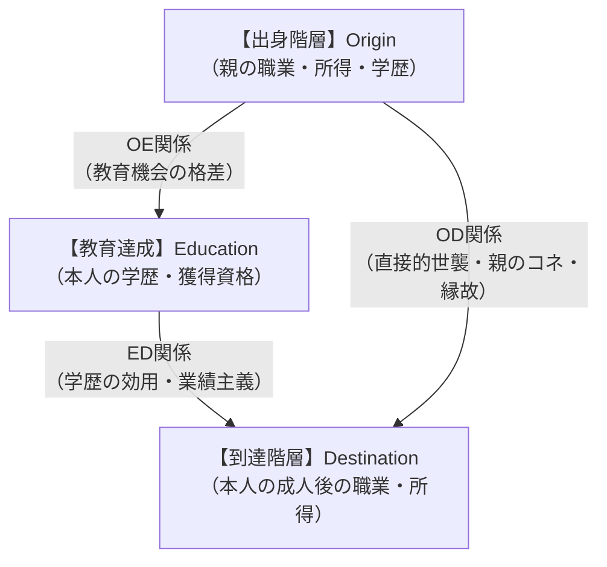
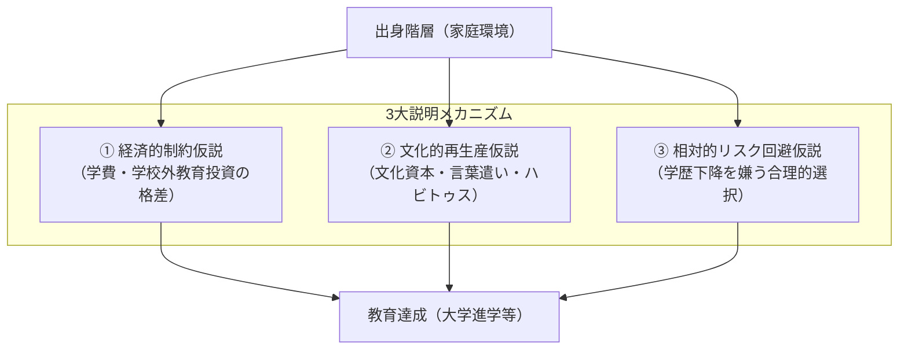

社会における教育の役割

授業で使用するスライドです。右下のボタンから全画面表示（Fキー）も可能です。

<!-- スライドの埋め込み部分 -->
<iframe class="slide-deck" src="Selection_Stratification_slide.html" width="100%" height="450px" style="border: 1px solid #dee2e6; border-radius: 4px;"></iframe>

[🔗 スライドを別タブで大きく開く](Selection_Stratification_slide.html){target="_blank"}

## 今日の目標

今回のテーマは、【教育と格差(1)：出身家庭と教育達成】

- 1）現代日本社会における「学歴と賃金・地位達成の関連（ED関係）」および「出身家庭と学歴の関連（OE関係）」の実態をデータで把握する
- 2）「近代」「社会階層」「OEDトライアングル」という概念を用いて、教育が社会の開放性や格差の再生産に果たす役割を論理的に説明できるようになる
- 3）出身家庭の格差が教育達成の格差へと変換される3大メカニズム（経済的制約仮説、文化的再生産仮説、相対的リスク回避仮説）を比較・検討できるようになる

## 社会階層と格差生成のメカニズム

### イントロダクション

前回の講義では、近代社会が「生まれ（属性）」ではなく「能力と努力（業績・学歴）」によって地位を配分するメリトクラシーを理想として掲げたことを確認した。では、今日の日本社会において、その「学歴」はいったいどれほど個人の処遇（収入や職業）を左右しているのだろうか。

まずは、身近な感覚から考えてみよう。

:::{.callout-important icon="false"}
## コメント(1)
次ページを見ずにイメージで答えてみてください。今日の日本社会で、50～54歳の頃の「大卒者」と「高卒者」の平均月収の差はどのくらい（何万何千円）だと思いますか。男性と女性、それぞれについて回答してください。
:::

厚生労働省の「賃金構造基本統計調査（令和6年）」によれば、50〜54歳時点でのフルタイム労働者の平均月収（所定内給与額）は以下のようになっている。

- **男性（50〜54歳）**
  - **大学・大学院卒：** 約54.6万円
  - **高校卒：** 約36.1万円
  - $\rightarrow$ **月額差：約18.5万円（年間では賞与を含め250万〜300万円以上の差、生涯賃金では数千万円〜約6,000万円前後の差）**
- **女性（50〜54歳）**
  - **大学・大学院卒：** 約39.8万円
  - **高校卒：** 約23.5万円
  - $\rightarrow$ **月額差：約16.3万円**

このように、現代日本においても学歴は依然として個人の経済的処遇を大きく左右する決定的な要因（**教育と地位達成の強い結びつき**）として機能している。

### 出身階層・学歴・到達階層：OEDトライアングル

社会学において、個人が社会の中で占める位置の不平等な構造を**「社会階層（Social Stratification）」**と呼ぶ。平沢和司（2014）によれば、社会階層とは「経済的資源（所得・資産）、関係的資源（職業的威信・権力）、文化的資源（学歴・知識・教養）の保有量が似通っている人々の集合体」である。

個人の一生における階層移動を分析する際、教育社会学では**「OEDトライアングル（社会移動モデル）」**という枠組みを用いる。

- **O（Origin：出身階層）｜** 生まれ育った家庭の社会経済的地位（親の学歴、世帯所得、親の職業など）
- **E（Education：教育達成）｜** 本人が最終的に達成した学校段階や専攻（中卒・高卒・専門卒・大卒・大学院卒）
- **D（Destination：到達階層）｜** 本人が大人になって最終的に到達した社会的地位（本人の職業、年収、雇用形態など）

#### 近代社会の理想とOEDトライアングルの関係

近代以前の身分社会と、近代が目指したメリトクラシー社会は、このOEDトライアングルの矢印の強さによって明確に対比できる。

1. **前近代の身分制社会（社会の開放性：極小）**
   - **ODの直接効果が支配的：** 親が武士なら子も武士、親が農民なら子も農民。学校教育（E）を経由することなく、出自（O）が直接本人の社会的地位（D）を決定する。
2. **完全なメリトクラシー社会（社会の開放性：最大）**
   - **ODの直接効果はゼロ：** 親のコネや世襲による配分は完全に排除される。
   - **OEの効果もゼロ：** 出身家庭の貧富に関係なく、万人に平等な教育機会が与えられ、本人の純粋な能力と努力だけで教育（E）が決まる。
   - **EDの強い効果：** 獲得した教育成果（E）に応じて公正に地位（D）が配分される。
3. **現代日本社会の現実（学歴を媒介とした不平等の再生産）**
   - 日本社会では、戦後の法制度改革や企業の新卒一括採用により、親のコネによる直接的継承（OD関係）は先進国の中でもかなり弱められた。
   - しかし、**「出身家庭（O）が良い子どもほど、高い学歴（E）を獲得しやすく、その学歴（E）を通じて高い地位（D）へと到達する」という間接的な媒介ルート（$O \rightarrow E \rightarrow D$）**が極めて強固に残っている。形式的には公正な試験に見えながら、実は学歴を隠れ蓑にして階層格差が世代間で再生産されているのである。

:::{.callout-important icon="false"}
## コメント(2)
あなたは、現代日本社会では何故、ODの直接的な関連（≠O→E→Dという関連、たとえば政治家の子どもが政治家になったり、金持ちの子どもが学歴に関係なく親のコネで金持ちになったり、など）が弱いのだと思いますか。歴史的観点や制度の側面、学校教育の話など、どのような観点からでも構いませんので、1つの観点から説明してみてください。
:::

## 出身階層と教育達成：格差生成の3大メカニズム

客観的なデータ（平沢 2014、松岡 2019など）を見ても、親の世帯年収や学歴が高い家庭ほど、子どもが四年制大学に進学する割合が圧倒的に高い。なぜ、出身階層（O）が子どもの教育達成（E）をこれほど強く規定してしまうのだろうか。

社会学では、主に以下の3つの有力なメカニズムが提唱されている。

### 1. 経済的制約仮説（経済資本の影響）

最も直感的で分かりやすい説明が、家庭の経済力による物理的制約である。

- **学校外教育費への投資格差｜**
   - 近年の教育格差研究（松岡 2019）が示すように、義務教育の公教育費は平等であっても、未就学期の習い事、小学校以降の学習塾・通信教育・家庭教師、夏期講習や模試など、学校外で投じられる教育費には世帯年収間で数百万円単位の圧倒的な格差が存在する。
- **高等教育の学費と生活費（直接費用と機会費用）｜**
   - 日本の大学授業料（私立大学初年度納付金は130万円超、国公立でも約80万円）は国際的に見ても公的支出が極めて低く、私費負担が重い。
   - 給付型奨学金の規模が限られてきた日本において、一人暮らしの仕送り費用や、進学せずに働いていれば得られたはずの収入（機会費用）を負担できる家庭でなければ、難関大学への進学を断念せざるを得ない。

### 2. 文化的再生産仮説（文化資本・ハビトゥスの影響）

フランスの社会学者ピエール・ブルデュー（Pierre Bourdieu）が提唱した、家庭の持つ**「文化的資源（文化資本）」**に着目する視点である。

- **親の学歴と学習環境｜**
   - 高学歴な親の家庭には、幼少期から多数の本や知育玩具、新聞・百科事典があり、知的好奇心を刺激する日常会話（抽象的思考や論理的言語運用＝バーンスタインの言う「精密コード」）が自然に交わされている。
- **学校文化との親和性（ハビトゥス）｜**
   - 近代学校のカリキュラムや評価基準は、中上流階級の文化（教養、読解力、自律的な態度）を「自然な標準」として設計されている。
   - 中上流家庭の子どもは、家庭での1次的社会化を通じてすでに身につけている身体的性向（ハビトゥス）が学校文化と完全に合致するため、特別な努力をしなくても「先生に褒められ、勉強が得意な子」として適応できる。一方で、労働者階層の子どもは、学校文化をよそよそしい異文化として感じ、自己肯定感を挫かれやすい。

### 3. 相対的リスク回避仮説（合理的選択理論アプローチ）

経済的・文化的な制約がなくても、親や生徒自身の**「合理的な進路選択」**の結果として格差が生まれるとする説明である（Breen and Goldthorpe 1997）。社会学者レイモン・ブードン（Raymond Boudon）の数理モデルを発展させたもので、日本では吉川徹（2019）の「学歴下降回避仮説」として知られる。

- **基本前提｜**
   - 人間は感情や偏見だけでなく、自らの利益とリスクを冷静に計算して行動する。
- **中核的テーゼ（親の階層からの下降回避）｜**
   - 人々にとって最大の動機は「親の階層よりも上昇すること」ではなく、**「生まれ育った親の階層から転落（下降移動）しないこと」**である。
- **進学行動の分岐｜**
   - **大卒の親を持つ子ども：** 大学に進学しなければ親の生活水準や社会的評価を維持できず「転落」となるため、多額の学費や浪人のリスクを冒してでも必死に四年制大学を目指す（強い進学動機）。
   - **高卒の親を持つ子ども：** 高校を卒業して安定した企業に就職できれば、親と同じ生活水準を維持できるため、多額の借金（奨学金）を背負ってまで大学へ行くことは「過度なハイリスク」と判断される。
- **結論｜**
   - たとえ学校教育が無償化され学費がゼロになっても、**「どの学歴で満足とするかという期待値・リスク計算の基準が親の階層によって異なる」**ため、自律的な進路選択に委ねる限り、出身階層による学歴格差は自然と再生産されてしまう。

:::{.callout-important icon="false"}
## コメント(3)
今回の授業を踏まえて、あなたが日本の文部科学大臣だったとしたら、出身階層に基づく教育達成の格差を完全に無くすことを目指して、どのような政策をおこなうか、教えて下さい。格差を縮小させる必要は無いと考える人もいると思いますが、今回は思考実験として、格差を縮小させることを前提に考えてみてください。
:::

## 次回に向けて／今日の課題

次回は、高校入試・大学入試の具体的な選抜現場と、学校から労働市場への就職（トランジション）の接続構造について分析します。

### 今回提出するもの

コメント（Canvas LMSより提出，1〜3は回答必須、以降は任意回答）

- **コメント(1)：** 50〜54歳時点での大卒と高卒の平均月収差の予想
- **コメント(2)：** 現代日本社会でODの直接的関連が弱い理由の考察
- **コメント(3)：** 出身階層による教育格差を是正するための文部科学大臣としての政策提案

## 文献リスト

### 引用した文献（学術文献のみ）

- Boudon, Raymond, 1973, *L'inégalité des chances: La mobilité sociale dans les sociétés industrielles*, Paris: Armand Colin.（＝杉山光信・幸田徹訳，1974，『機会の不平等――産業社会における社会移動』みすず書房．）
- Bourdieu, Pierre and Jean-Claude Passeron, 1970, *La reproduction: Éléments pour une théorie du système d'enseignement*, Paris: Éditions de Minuit.（＝宮島喬訳，1991，『再生産――教育・社会・文化』藤原書店．）
- Breen, Richard and John H. Goldthorpe, 1997, "Explaining Educational Differentials: Towards a Formal Rational Action Theory," *Rationality and Society*, 9(3): 275-305.
- 平沢和司，2014，『格差の社会学入門――学歴と階層から考える』北海道大学出版会．
- 吉川徹，2019，『学歴と格差・不平等［増補版］――成熟する日本型学歴社会』東京大学出版会．

### 推奨文献

- 松岡亮二，2019，『教育格差――階層・地域・学歴』ちくま新書．
- 苅谷剛彦，1995，『大衆教育社会のゆくえ――学歴主義と平等神話の構造』中央公論社．
