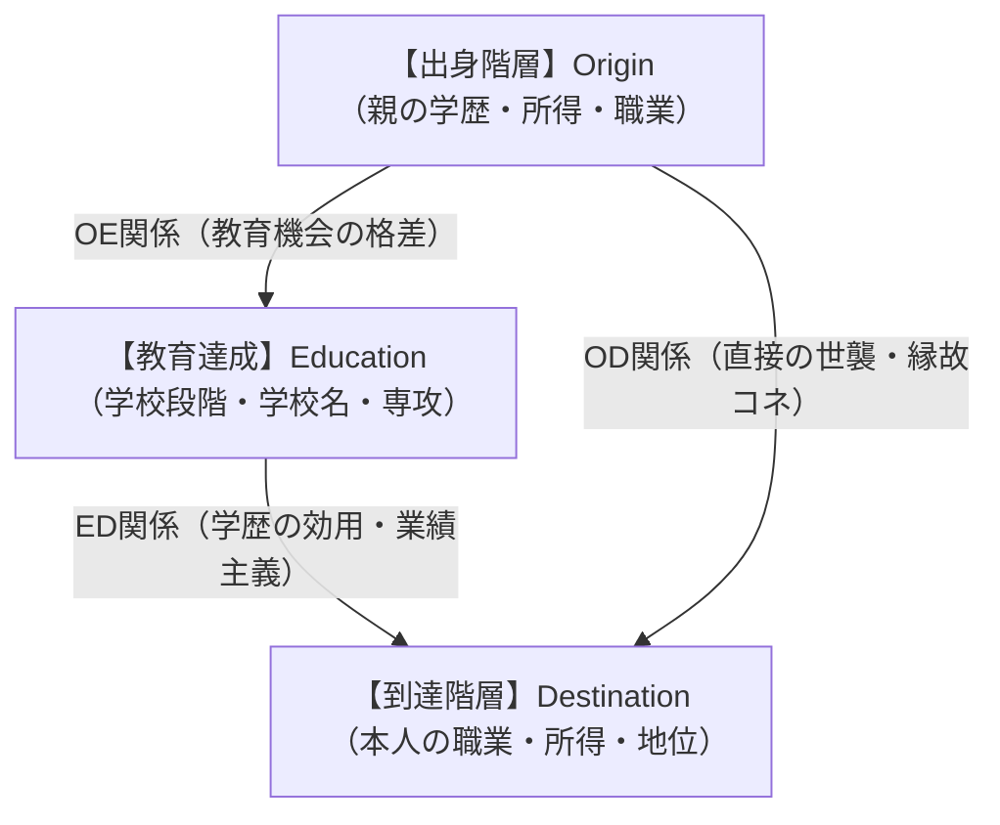
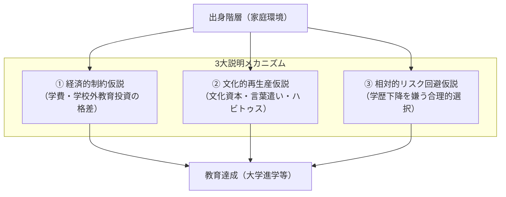

## 今日の目標

今回のテーマは、**教育と社会階層、学力の階層差**

- 1）現代日本社会における「学歴と賃金・地位達成の関連（ED関係）」および「出身家庭と学歴の関連（OE関係）」の実態をデータで把握する
- 2）「近代」「社会階層」「OEDトライアングル」という概念を用いて、教育が社会の開放性や格差の再生産に果たす役割を論理的に説明できるようになる
- 3）出身家庭の格差が教育達成の格差へと変換される3大メカニズム（経済的制約仮説、文化的再生産仮説、相対的リスク回避仮説）を比較・検討できるようになる
- 4）学校段階での学力に階層による違いがあることを理解する

## 社会階層と格差生成：イントロダクション{.scrollable}

- **前回の振り返り**
  - 近代社会は「生まれ（属性）」ではなく「能力と努力（業績・学歴）」によって地位を配分するメリトクラシーを目指した
- **問い**
  - 今日の日本社会において、「学歴」はいったいどれほど個人の処遇（収入や職業）を左右しているのか？
- **「学歴不問論」への批判的検討**
  - 「もはや学歴は重要ではない」という言説もあるが、平均的・統計的に見れば学歴による差は依然として明確であり、大学進学の経済的メリットは大きい

## 学歴による賃金格差の実態{.scrollable}

厚生労働省「賃金構造基本統計調査（令和6年）」（50〜54歳・フルタイム労働者）：

- **男性（50〜54歳）**
  - **大卒・院卒：約54.6万円** ／ **高卒：約36.1万円**
  - $\rightarrow$ **月額差：約18.5万円**（賞与含め年収差は250万〜300万円以上、生涯賃金差は数千万円〜約6,000万円）
- **女性（50〜54歳）**
  - **大卒・院卒：約39.8万円** ／ **高卒：約23.5万円**
  - $\rightarrow$ **月額差：約16.3万円**
- **結論**
  - 現代日本においても学歴は個人の経済的地位を大きく左右する決定要因（**強固なED関係**）

## OEDトライアングル（社会移動モデル）{.scrollable}

個人の一生における地位移動を捉える基本フレームワーク：

- **社会階層（Social Stratification）**
  - 経済的資源（所得・資産）、関係的資源（職業的威信・権力）、文化的資源（学歴・教養）を足し合わせた総合的な位置づけ（平沢 2014）

## 社会体制とOEDトライアングル{.scrollable}

1. **前近代の身分制社会（開放性：極小）**
   - **OD関係が支配的**：出自（O）が学校（E）を経ずに地位（D）を直接決定
2. **完全なメリトクラシー社会（開放性：最大）**
   - **OD効果＝ゼロ**：親のコネや世襲は完全に排除
   - **OE効果＝ゼロ**：家庭環境に関係なく、本人の能力と努力のみで教育が決まる
   - **ED効果のみが機能**：獲得した教育成果に応じて公正に地位が配分
3. **現代日本社会の現実（学歴を媒介とした不平等の再生産）**
   - 農地改革などの戦後法制度改革や新卒一括採用により、直接的継承（OD関係）はかなり弱められた
   - しかし、**「出身家庭（O）が良い子ほど高い学歴（E）を獲得し、高い地位（D）へ到達する」という間接ルート（$O \rightarrow E \rightarrow D$）**が極めて強固

## コメント(1)

:::{.callout-important icon="false"}
## コメント(1)
あなたは、現代日本社会では何故、ODの直接的な関連（≠O→E→Dという関連、たとえば政治家の子どもが政治家になったり、金持ちの子どもが学歴に関係なく親のコネで金持ちになったり、など）が弱いのだと思いますか。歴史的観点や制度の側面、学校教育の話など、どのような観点からでも構いませんので、1つの観点から説明してみてください。
:::

## 出身階層と教育達成：3大メカニズム{.scrollable}

親の所得や学歴が高いほど、子どもの大学進学率が高いのはなぜか？

## 1. 経済的制約仮説（直接費用と機会費用）{.scrollable}

- **学校外教育費への投資格差**
  - 義務教育は無償でも、習い事、塾、通信教育など**学校外教育費に世帯年収間で圧倒的な格差**（松岡 2019など）
- **直接費用（学費・生活費）**
  - 私立大初年度納付金は130万円超、国公立も約80万円。公的支出が低く私費負担が重い。首都圏・関西圏への進学では一人暮らしの仕送りも必要
- **機会費用の重み**
  - 進学せずに働いていれば得られたはずの収入（高卒初任年収約250万円）。直接費用以上に大きい
  - 人的投資としての利回り（内部収益率7〜8%）は高いが、「すぐに家にお金を入れる必要がある」困窮層では機会費用の大きさから進学断念につながる

## 2. 文化的再生産仮説（文化資本とハビトゥス）{.scrollable}

- **ピエール・ブルデュー（Pierre Bourdieu）の理論**
  - 学校は客観的中立を装いながら、実際には**支配階層の文化を「正統なもの」として評価・運用**している
- **親の学歴と文化的資源（文化資本）**
  - 蔵書数、知育体験、美術館訪問、論理的な語彙運用（バーンスタインの「精密コード」）
- **ハビトゥス（身体化された性向）と学校適応**
  - **中上流層の子ども**：家庭環境と学校文化が自然に合致し、「優秀な生徒」として振る舞える
  - **労働者層の子ども**：学校文化に疎外感を抱きやすく、適応困難になりやすい

## 3. 相対的リスク回避仮説（学歴下降回避）{.scrollable}

- **ブードン／ブリーン＆ゴールドソープ（1997）**
  - 経済的・文化的制約がなくても、**親子の合理的な選択・リスク計算**によって格差が生まれる（吉川 2019：学歴下降回避仮説）
- **中核的動機：親の階層からの下降（転落）回避**
  - 人間は「上昇」よりも**「生まれ育った階層水準を下回らないこと」**を強く志向する
- **合理的な進路選択の分岐**
  - **大卒の親を持つ子**：非大卒になることは「転落」であるため、高いコストや浪人のリスクを冒してでも大学を目指す
  - **高卒の親を持つ子**：高卒で安定就職できれば親の地位を維持できるため、借金（奨学金）を抱えての大学進学は「過大なリスク」とみなされやすい

## 学力と社会階層：実態（SESと学力）{.scrollable}

- **家庭環境による学力格差**
  - 親の学歴、職業、世帯所得などの**社会経済的地位（SES: Socioeconomic Status）**が高い家庭の子どもほど、学力テストの正答率や学業成績が高い
  - 文部科学省の全国学力テスト分析でも、世帯年収や学校外教育支出の増加に伴って算数・国語の正答率が明瞭に上昇する傾向が確認されている
- **学力の階層差という現実**
  - 単に「進学するかどうか（進路選択）」だけでなく、その前段階である**「学校段階での学力形成そのもの」**にすでに大きな階層格差が生じている

## 学力格差を生み出すメカニズム{.scrollable}

学力の階層差は、複合的な要因を通じて生じる：

- **経済資本と学校外教育投資**
  - 塾、習い事、個別学習環境への早期投資。大都市近郊では通塾が算数学力を押し上げる強力な要因
- **文化資本と子育てスタイル**
  - 読書習慣、親子の対話（精密コード）。中産階級の「意図的な養育（Concerted cultivation）」vs 労働者階級の「放任的養育」
- **努力格差・教育期待格差**
  - 「努力すれば報われる」という信念自体が階層と連動。高SES層の親の高い期待を子どもが内面化し、学年が上がるほど学習時間（努力量）の格差が拡大
- **地域的文脈（地域多様性）**
  - 通塾・私立受験競争が激しい大都市圏と、穏やかな地方小都市でSESの学力説明力に違いが存在

## メリトクラシーの揺らぎと学校制度{.scrollable}

- **メリトクラシーからペアレントクラシー（親力主義）へ**
  - 近代は「能力＋努力＝業績（メリット）」による選抜を掲げたが、その**「業績（学力）」自体が親の富や教育戦略によって作られている**
  - 実態は、親の資産と願望が子どもの進路を左右する「ペアレントクラシー」へと変質しているという批判
- **学校SESと高校トラッキングによる格差の固定化**
  - 公立校でも居住地域の階層を反映して学校平均学力・進学期待（学校SES）に格差が生じる
  - 高校入試（トラッキング）により、進学校（高SES層集積）と困難校（低SES層集積）へ輪切りにされ、学力差が階層の隔離と再生産につながる

## 教育社会学からの示唆・対策{.scrollable}

- **「形式的平等」の見直し**
  - 初期条件（家庭のSES）に大きな開きがある中で、学校が全員に「一律・同じ扱い」を施すだけでは、格差は縮小せず、むしろ「本人の能力差」として正当化されてしまう
- **早期介入と学校現場での傾斜的支援**
  - 幼少期の文化資本格差を中和する「質の高い公的保育・幼児教育サービスの保障」（エスピンーアンデルセン）
  - 困難校・困難地域への傾斜的な教育資源の配分
  - 学力低位層に焦点を当てた丁寧な学習指導・家庭支援

## コメント(2)

:::{.callout-important icon="false"}
## コメント(2)
今回の授業を踏まえて、あなたが出身階層に基づく教育達成の格差を完全に無くすことを目指して介入を行うことができるとすれば、どのような介入を行いますか。

思考実験として、あらゆる手段を採用できる立場だと考えて、介入を考えてみてください。倫理的な問題や現実的な実施可能性などは考慮せず、考えてみましょう。
:::

## 今日の課題

### 今回提出するもの

コメント（Canvas LMSより提出，1〜2は回答必須、以降は任意回答）

- **コメント(1)：** 現代日本社会でODの直接的関連が弱い理由の考察
- **コメント(2)：** 出身階層による教育格差を是正するための介入（思考実験）
