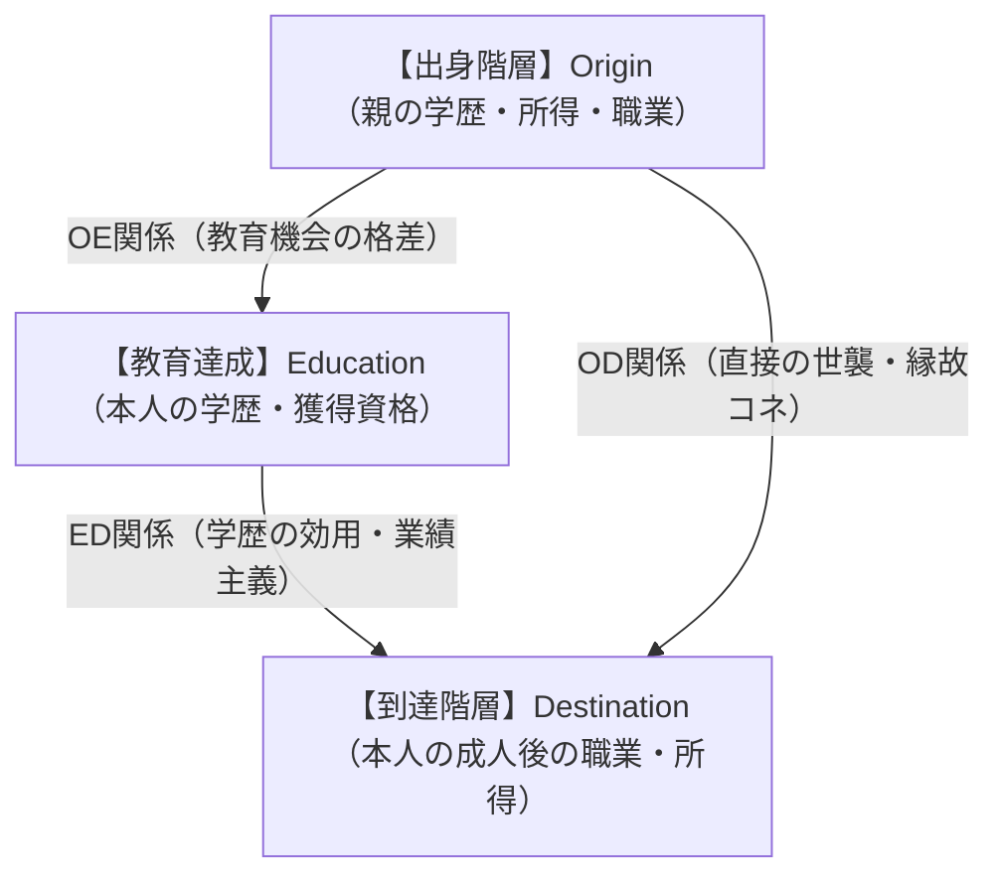
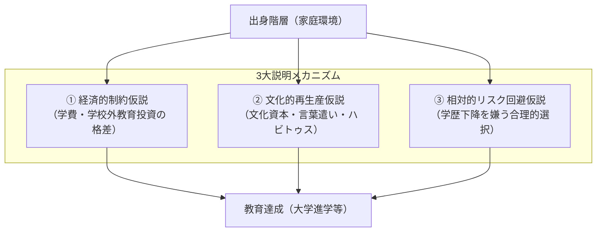

## 今日の目標

今回のテーマは、【教育と格差(1)：出身家庭と教育達成】

- 1）現代日本社会における「学歴と賃金・地位達成の関連（ED関係）」および「出身家庭と学歴の関連（OE関係）」の実態をデータで把握する
- 2）「近代」「社会階層」「OEDトライアングル」という概念を用いて、教育が社会の開放性や格差の再生産に果たす役割を論理的に説明できるようになる
- 3）出身家庭の格差が教育達成の格差へと変換される3大メカニズム（経済的制約仮説、文化的再生産仮説、相対的リスク回避仮説）を比較・検討できるようになる

## 社会階層と格差生成：イントロダクション{.scrollable}

- **前回の振り返り**
  - 近代社会は「生まれ（属性）」ではなく「学歴・業績」で処遇を決めるメリトクラシーを目指した
- **問い**
  - 現代日本において、学歴はどれほど個人の処遇（収入や職業）を左右しているのか？

## コメント(1)

:::{.callout-important icon="false"}
## コメント(1)
次ページを見ずにイメージで答えてみてください。今日の日本社会で、50～54歳の頃の「大卒者」と「高卒者」の平均月収の差はどのくらい（何万何千円）だと思いますか。男性と女性、それぞれについて回答してください。
:::

## 学歴による賃金格差の実態{.scrollable}

厚生労働省「令和6年度賃金構造基本統計調査」（50〜54歳・フルタイム労働者）：

- **男性（50〜54歳）**
  - **大卒・院卒：約54.6万円** ／ **高卒：約36.1万円**
  - $\rightarrow$ **月額差：約18.5万円**（賞与含む年収差は250万〜300万円以上、生涯賃金差は数千万円〜約6,000万円）
- **女性（50〜54歳）**
  - **大卒・院卒：約39.8万円** ／ **高卒：約23.5万円**
  - $\rightarrow$ **月額差：約16.3万円**
- **結論**
  - 日本社会においても学歴は個人の経済的地位を決定づける極めて強力な要因（**強固なED関係**）

## OEDトライアングル（社会移動モデル）{.scrollable}

個人の一生における地位移動を捉える基本フレームワーク：

- **社会階層（Social Stratification）**
  - 経済的資源、関係的資源、文化的資源の保有量が似ている人々の集合体（平沢 2014）

## 社会体制とOEDトライアングル{.scrollable}

1. **前近代の身分制社会（開放性：極小）**
   - **OD関係が支配的**：出自（O）が学校（E）を経ずに地位（D）を直接決定
2. **完全なメリトクラシー社会（開放性：最大）**
   - **OD効果＝ゼロ**：親のコネや世襲は完全に排除
   - **OE効果＝ゼロ**：家庭環境に関係なく、本人の能力と努力のみで教育が決まる
   - **ED効果のみが機能**：教育成果に応じて公正に地位が配分
3. **現代日本社会の現実（学歴を媒介とした不平等の再生産）**
   - 法的世襲やコネ（OD効果）は比較的小さい
   - しかし、**「出身家庭（O）が良い子ほど高い学歴（E）を得て、高い地位（D）に就く」という間接ルート（$O \rightarrow E \rightarrow D$）**が極めて強固

## コメント(2)

:::{.callout-important icon="false"}
## コメント(2)
あなたは、現代日本社会では何故、ODの直接的な関連（≠O→E→Dという関連、たとえば政治家の子どもが政治家になったり、金持ちの子どもが学歴に関係なく親のコネで金持ちになったり、など）が弱いのだと思いますか。歴史的観点や制度の側面、学校教育の話など、どのような観点からでも構いませんので、1つの観点から説明してみてください。
:::

## 出身階層と教育達成：3大メカニズム{.scrollable}

親の所得や学歴が高いほど、子どもの大学進学率が高いのはなぜか？

## 1. 経済的制約仮説（経済資本の影響）{.scrollable}

- **学校外教育投資の格差**
  - 義務教育は無償でも、未就学期の習い事、小中高の学習塾・通信教育・模試代など、**学校外教育費に世帯年収間で数百万円の格差**（松岡 2019）
- **高等教育の学費と生活費負担**
  - 私立大初年度納付金は130万円超、公的支出の少なさ
  - 給付型奨学金の不足、一人暮らしの仕送り費用
  - 進学せずに働いた場合の収入（機会費用）を負担できる家庭に限定される

## 2. 文化的再生産仮説（文化資本の影響）{.scrollable}

- **ピエール・ブルデュー（Pierre Bourdieu）の理論**
  - 学校は中性的な場ではなく、**支配階層の文化を「客観的基準」として運用**している
- **親の学歴と家庭の文化的資源**
  - 蔵書数、芸術・知育体験、論理的な語彙（バーンスタインの「精密コード」）
- **ハビトゥス（身体化された性向）と学校適応**
  - 中上流層の子ども：家庭の身体感覚と学校文化が一致し、自然と「優秀な生徒」として評価される
  - 労働者層の子ども：学校文化が異文化に感じられ、劣等感・疎外感を抱きやすい

## 3. 相対的リスク回避仮説（合理的選択論）{.scrollable}

- **ブードン／ブリーン＆ゴールドソープ（1997）**
  - 経済的・文化的制約がなくても、**親子の合理的なリスク計算**によって格差が生じる（吉川 2019：学歴下降回避仮説）
- **中核的動機：親の階層からの下降（転落）回避**
  - 人間は「上昇」よりも**「生まれ育った生活水準を下回らないこと」**を最優先する
- **合理的な進路選択の分岐**
  - **大卒の親を持つ子**：大卒未満になることは「転落」であるため、学費や浪人のリスクを冒してでも必死に大学を目指す
  - **高卒の親を持つ子**：高卒で安定雇用に就ければ親の地位を維持できるため、借金（奨学金）してまでの進学は「過大なリスク」とみなされる

## コメント(3)

:::{.callout-important icon="false"}
## コメント(3)
今回の授業を踏まえて、あなたが日本の文部科学大臣だったとしたら、出身階層に基づく教育達成の格差を完全に無くすことを目指して、どのような政策をおこなうか、教えて下さい。格差を縮小させる必要は無いと考える人もいると思いますが、今回は思考実験として、格差を縮小させることを前提に考えてみてください。
:::

## 今日の課題

### 今回提出するもの

- コメント（Canvas LMSより提出，1〜3は回答必須、以降は任意回答）
  - **コメント(1)：** 50〜54歳時点での大卒と高卒の平均月収差の予想
  - **コメント(2)：** 現代日本社会でODの直接的関連が弱い理由の考察
  - **コメント(3)：** 出身階層による教育格差を是正するための文部科学大臣としての政策提案