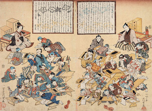
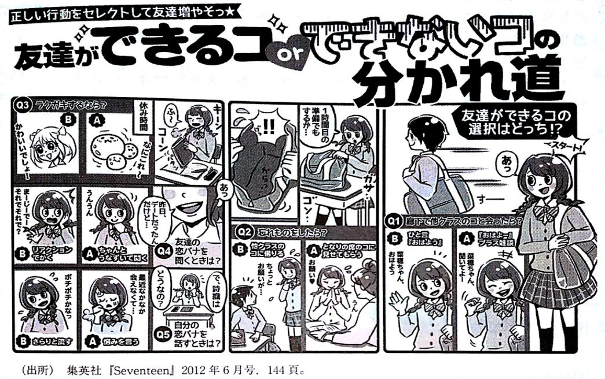
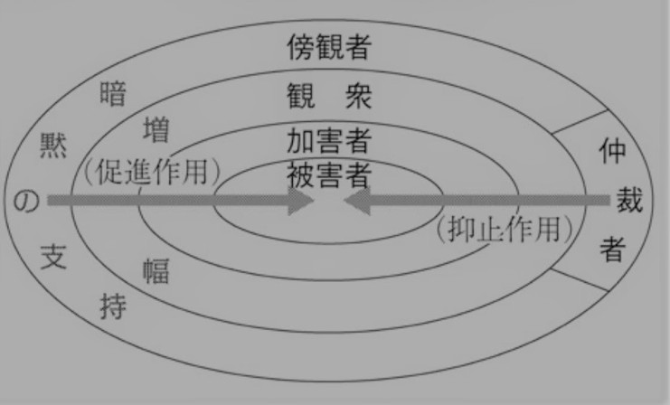

<!-- 授業で使用するスライドです。右下のボタンから全画面表示（Fキー）も可能です。 -->

<!-- <!-- スライドの埋め込み部分 --> -->
<!-- <iframe class="slide-deck" src="Socialization_Curriculum_Class_slide.html" width="100%" height="450px" style="border: 1px solid #dee2e6; border-radius: 4px;"></iframe> -->

<!-- [🔗 スライドを別タブで大きく開く](Socialization_Curriculum_Class_slide.html){target="_blank"} -->

## コメントへのフィードバック

###

- コメント提出時に、人によってコピー元（前回と同じものなど）が表示されることがあります。その場合、(1)再読み込み、(2)一度未入力状態で送信・提出すると解消しそうです。
- 「授業のスライドがまとまってるファイルがほしい」
   - $\rightarrow$ うまくひとまとめにする方法を調べているので、少々お待ちください
- 「教育も社会学的に考えられる授業なので、必ず自分も対象者なので面白い」
   - $\rightarrow$ 社会学の特徴として、社会を観察する側（社会学者など社会学的に考察する側）も必ず社会の中にいるため内部観察にならざるをえないという面を強調する立場（佐藤俊樹 , 2009, 『社会学の方法』ミネルヴァ書房）があります。
   - 教育に関しては、基本的に全員が教育を受けてきたのでその面が意識しやすいかもしれません

### これまで経験した初等教育、中等教育、高等教育のうち、あなたが今後社会で生きていく上で最も役に立ちそうなのはどの段階か

::: {.callout-note collapse="true"}

## 具体的なコメント一覧



:::

#### **1. 学校段階ごとの理由整理（多数派 vs 少数派）**

どれがより重要であるかは、まったく答えがある問題ではありません。いちおう学術的には、**収益率（私的収益率/社会的収益率）**という概念から、より低い学校段階ほど収益率が高いと考えられています（ヘックマン, 2015, 『幼児教育の経済学』東洋経済新報社）。低い学校段階で習っていることが、想像以上に社会全体を底上げしていると考えるとイメージしやすいと思います。

#### 【初等教育】

- 多数派の理由：「生きるための絶対的基盤（土台）の獲得」
   - 認知的基礎：読み書き、四則演算（これがないと中高等教育の応用が成り立たない）。
   - 基本的社会化：挨拶、5分前行動、時間管理、他者への我慢や集団生活のルール。
   - 「後で学ぶ専門知よりも、アルバイトや社会生活で現実に毎日使っているのは小学校で刷り込まれた習慣だ」という実感。
- 少数派の理由：
   - 幼稚園・就学前との対比：「小学校だけでなく幼稚園での理不尽に怒られた経験や、周りの士気を下げない訓練が原体験になっている」。
   - 人間関係のネガティブな学習（摩擦の経験）：「最もいじめや仲間はずれ、悪口が活発だったからこそ、どういう行動が嫌われるか・好まれるかを学んだ」。

#### 【中等教育】
- 多数派の理由：「『準・大人』としての集団関係と自己選択」
   - 組織的・上下関係の社会化：部活動（特に野球部など）を通じた先輩・後輩関係、礼儀・敬語、チームワーク、行事（合唱祭・体育祭）での利害調整。
   - 進路選択と自己形成：高校・大学受験や文理選択を通じて、「自分が何をしたいのか」「将来どう生きるか」に向き合う最初の契機。
- 少数派の理由：
   - 制度的足切りライン：「日本社会で就職するための最低条件（高卒資格）だから」。
   - 学問的探究・挫折の昇華：「探究型の授業で問いを立てる経験をした」「合わない人との人間関係のストレスや恋愛の失敗が、社会学を学ぶモチベーションになった」。

#### 【高等教育】

- 多数派の理由：「『管理』から『自己責任（自律）』への環境変化」
   - 履修登録、教科書購入、スケジューリングなど、守られた環境から「すべて自分で決めて責任を取る」訓練。
   - 「正解のある問い（初等・中等）」から「正解のない問いに向き合い、根拠を持って批判的に考える力（ゼミ・レポート）」への転換。
- 少数派の理由：
   - 多様な背景を持つ他者との遭遇：大規模な講義や異なる出身地・環境の学生と関わる経験。
   - 学問的専門性の獲得：一つの分野を本気で学ぶことで、物事を多角的に捉える「レンズ」を手に入れたこと。

#### **2. まとめ: 学校段階ごとの違い**

各学校段階のときに初期段階での学校への不適応を示す用語が存在します（小1プロブレム、中1ギャップ、高1ギャップ（高1クライシス）、大学不適応）。たとえば、次のようなものです。

- 就学前 $\rightarrow$ 初等（小1プロブレム）：
   - 家庭や幼稚園・保育園という「感情や遊び中心の空間」から、「45分間着席し、チャイムで区切られ、一斉行動を強いられる空間」への急激な身体的調教。自由を奪われ「規格化された児童」に作り替えられる最初の摩擦。
- 初等 $\rightarrow$ 中等（中1ギャップ）：
   - 緩やかな学級担任制から、教科担任制・定期テスト（明確な点数序列化）・部活動の先輩後輩（強固な縦社会）へと移行。「子ども同士の横の関係」から「社会の階層・競争・権力構造の相似形」へと放り込まれる摩擦。

こうした不適応の典型的な形は、それぞれの学校段階の特徴を示している面があると理解できます。

### 中学校における公教育制度の、政治的視点からの意義

::: {.callout-note collapse="true"}

## 具体的なコメント一覧



:::

#### 多数派のタイプ分け（3つの類型）

- タイプA：代表制民主主義・選挙プロセスの擬似体験型（最多）
   - 主な着眼点：生徒会長選挙、学級委員・実行委員の投票、演説、選挙管理委員会の設置、匿名投票。
   - 理由など：
    - 「公約を掲げて立候補する／演説を聞いて投票する」という一連の手続きが、将来の国政・地方選挙の予行演習になっている。
    - 投票という行為を通じて、「代表者を選び、その結果を受け入れる」という民主主義の基本ルールを身体化している。
- タイプB：熟議・合意形成と少数意見の調整型
   - 主な着眼点：学級会、文化祭・体育祭のルール作りや出し物決め、生徒会での討議。
   - 理由など：
      - 単に知識を学ぶだけでなく、「異なる意見を持つ他者と話し合い、妥協点を見つけて1つの案にまとめる（合意形成）」プロセスを学んでいる。
      - 多数決の使い方や、少数派の意見をどう扱うかといった、集団自治のリアリズムを学ぶ場として捉えている。
-タイプC：教科教育（知識・制度理解）型
   - 主な着眼点：中学3年の公民（三権分立、地方自治、選挙制度）、他国との比較。
   - 理由など：
      - 主権者として民主主義社会を適切に運営・維持するために不可欠な「社会の仕組みや法的ルール」を体系的に身につける場。

#### 少数派の視点

- 「政治のドロドロした現実（ポピュリズム・人気投票）」への冷徹な着眼
   - 「公約より仲のいい人に投票する人が多かった。それも含めて現実の政治の縮図だった」
   - 「運動会と選挙が混ざったイベントで、人の声を集めるにはどんな人物・活動が好まれるか考えさせられた」
   - 教科書通りの「正しい民主主義」ではなく、人気投票や関係性で票が動く現実の力学が中学生なりに体感されている。
- 当事者（元・生徒会長）による「統治の困難さ」の実感
   - 「良かれと思って出した案が、ある人にとっては不利益になり通用しないことを知った」「自分が社会を運営するのに適した人間だと認められる難しさを知った」
   - 代表者の側に立ったことで、「万人にとっての正解は存在しない」「政策には必ず利害対立が伴う」という統治（ガバナンス）の難しさを身体で学んだケース。
- 教科の枠組みを使った「イデオロギー装置」としての学校
   - 国語：「国語の文章題（戦争の悲惨さ、民主主義論）の選定に、教育者の政治的意図が反映される」。
      - 国語教育に道徳教材的な意味があると指摘する議論もあります（石原千秋, 2005, 『国語教科書の思想』/, 2009,『国語教科書の中の「日本」』筑摩書房）
   - 歴史：「日本史を学ぶことで愛国心を育てているのではないか」。
   - 学校が単に手続きを教えるだけでなく、国家への帰属意識や特定の価値観を醸成する「国民統合のイデオロギー装置」であることを見抜いた視点。
- 政治と「経済構造（資本主義・財政）」の連動
   - 時間規律と資本主義：「時間を守ることを重視するのは、効率を重んじる資本主義社会に合った人材を育てるため」。
   - 財政・資源制約の体験：「文化祭の出し物で、決められた予算の中でいかに効率的に作るかを体験した」。
   - シミュレーション：「社会科で内閣作りだけでなく株運用のシミュレーションをやった」。

### 明治時代の日本にはなかった、今日の日本社会における公教育の意義/明治時代の公教育と、現代の公教育ではどのような役割の変化

::: {.callout-note collapse="true"}

## 具体的なコメント一覧



:::

個性の時代とかっていうけど、昔の人も個性はあったはず。

完全に分けきれるわけでもないけど、社会化は同じものを共有する方向、選抜・配分は分かれる方向

答えはないけど、オンラインなどの選択肢が出るなかで、これまで学校に行かないとできなかったことができるようになる面がある。また、（実際には教員不足の問題はあるけれど）児童生徒が減っている中で、何とか間に合わせるような学校数・教員数だったところからより余裕を持たせることもできるかもしれない（人件費をかける必要はあるけど）

---

#### 共通意見

「国家のための教育」から「個人のための教育」への転換という基本図式を共有しており、具体的には以下の3つの対比に集約された。

#### **目的の転換：「国家の統合・富国強兵」 $\rightarrow$「個人の尊重・自己実現」**

- 明治：欧米列強に対抗し、国力を高め、同じ型（共通の言葉・知識・愛国心）にはまった国民・従順な労働者を育成する。
- 現代：個人の尊厳、ウェルビーイング、自分らしく生きる力、興味関心に応じた進路選択（文理選択・高等教育化）。

#### **社会像の転換：「画一性（モノカルチャー）」 $\rightarrow$ 「多様性（ダイバーシティ）と共生」**

- 明治：身分や地域でバラバラだった人々を「単一の日本人」へと同質化・統合する。
- 現代：性別、文化、家庭環境、価値観が異なる他者と対話し、共に社会をつくる力（18歳選挙権、主権者教育）。

#### **学びの質の転換：「知識の暗記・一方的伝達」 $\rightarrow$ 「主体的思考・情報判断力」**

- 明治：国が定めた正解・基礎知識を効率よく詰め込む。
- 現代：膨大な情報やSNSの中で真偽を見極めるメディアリテラシー、正解のない問いを自分で考える力（入試改革の実感など）。

#### 少数派意見

- **社会史的な着眼：「子どもの発見」と労働からの解放**
   - 「明治以降、子どもが『小さいながら重要な働き手』から『教育を受けなければならない存在』へと変わっていった」という指摘。
   - フィリップ・アリエス的な「子どもの誕生」や、児童労働の禁止と義務教育の普及という歴史的変化に対応した指摘。
- **「社会権・福祉的セーフティネット」としての公教育**
   - 「家庭環境や経済状況に関係なく、誰もが教育を受ける権利の保障」「塾に行けなくても学校で学べる機会均等」「不登校や外国籍の子どもへの包摂」。
   - 単なる自己実現だけでなく、教育を「福祉国家における最低限の権利保障（セーフティネット）」として捉える視点。
   - 男女別学の解消や、家庭科の男女共修化、教育費負担の軽減策なども含めて、昔はより限定的なグループを対象としていたものが、より対象を広めるという変化が生じることが多い
- **「制度の定着（正統化）」がもたらした意識の変化**
   - 「明治期は学校に通わせることに反対する運動（一揆など）もあったが、現代は行くのが当たり前になった」。
   - 制度が社会に完全に埋め込まれ、「当たり前の前提」として自明化した歴史的プロセスへの着目。
- **収斂・標準化と多様化・個性尊重の矛盾**
   - 「言語の収斂（方言の消失など）を考えると、明治より現代の方が教育によって国民を統一しようとする傾向が大きい気もするが、社会の風潮としては『多様性』を強調している。これはなぜだろう？」
   - はっきりしたことは分かりませんが、直感的には、制度的にはかつてないほど均質化（標準化）されているからこそ、理念として「多様性」を掲げているという面があると思われる。
   - さらに言えば、教育学の中では（とくにカリキュラムや学習指導の文脈で）、**経験主義（子どもの興味や体験をもとに、実際の経験を通じた学習を重視）**と**系統主義（知識や技能を、定まった順序に沿って系統的に学習することを重視、詰め込み的）**という2つの立場があり、それが対立しつつどちらも重要なので振り子のように行き来してきた歴史がある（志水 2009）。

#### まとめ

- 明治時代は、自分たちのことを「日本国民」だと思っていない人たち（○○藩の人間、××村の人間だと思っている人たち）を国民にする必要があったが、現代社会ではそれがある程度達成されており、わざわざそれをするまでもないという面もあるはず。（国際的なスポーツイベント…）
- それをもって、「社会が変わったから教育も変わる/変わった/変わるべき」と理解することもできるが、だからといった、「個性を大事にして共通で習う部分がいらない」などと考えるなら、それも極論といえるはずである

## 今日の目標

今回のテーマは、カリキュラムと知識の性質、および学級・ホームルームという仕組みです。

- 1）学校で教えられる「知識」の性質や、「隠れたカリキュラム」について理解する
- 2）学級という空間がどんな特徴を持っているのかを整理する
- 3）学級という仕組みがどのような変遷を経て出来上がってきたのかを歴史的に理解する
- 4）学級の特徴が、特に生徒間の人間関係（いじめやスクールカースト）という観点からどんな影響力を持ちうるのかを考える

## カリキュラムと知識

### イントロダクション

:::{.callout-important icon="false"}
## コメント(1)
これまで学校で習ってきたこと（授業内で教えられたり練習したこと、教科書や学校からの配布物に書かれていることなど）のうち、「なぜこれを習うんだろう」と思った経験や、その内容が「○○の人たちには有利だけど、自分には難しいな」（または反対に自分には有利）だと感じた経験について思い出して書いてみましょう。

:::

### 学校教育で子どもたちは何を学ぶのか

学校という場所は、子どもたちが国語や算数といった教科の知識を身につけるための場所だと一般には考えられている。学習指導要領や時間割によってあらかじめ定められ、教科書を通じて意図的かつ明示的に教えられるこれらの学習内容は、**「公式のカリキュラム（顕在的カリキュラム）」**と呼ばれる。

しかし、教育社会学の視点から見ると、子どもたちが学校で学んでいるのは教科の知識だけではない。学校という特有の空間で集団生活を送る中で、子どもたちは暗黙のうちにさまざまな社会のルールや価値観、態度を身につけていく。このように、学校の意図とは別に（あるいは意図を超えて）、学校生活の仕組みや日常的な実践を通じて潜在的に学習されるものは、**「隠れたカリキュラム（潜在的カリキュラム：hidden curriculum）」**と呼ばれる。

例えば、チャイムの音に合わせて行動を切り替えることで「時間規律」を身体化したり、教師の指示に従うことで「権威への従順さ」を学んだり、定期試験やそれにもとづく成績評価を通じて「競争とそれに対する評価は当然のものである」という価値観を受け入れる、といったことが挙げられる。さらには、「男子は重いものを運び、女子は細やかな気配りをする」といった性別役割分業なども、隠れたカリキュラムとして機能することがある。

ただし、これらは日常的な働きかけの中で行われる面が強く、仮説としては興味深くそうした面があるかもしれないとは思えるが、やや科学的に「隠れたカリキュラム」が存在しており、機能しているとは主張しにくい面もある（因果関係が不明確・学校が原因とは限らない）。

### 知識の社会的構成――「何が」教えられているのか

さらに踏み込んで、「そもそも学校で教えられている『公式のカリキュラム（正しい知識）』とは何なのか？」を問い直す視点が、1970年代以降の「新しい教育社会学」（M.F.D. ヤングら）によって提示された。

- 旧来の教育社会学（機能主義）：
   - インプット（家庭環境など児童生徒のバックグラウンド）とアウトプット（学歴・階層）の「相関関係」を測定し、学校を「社会を効率よく回すための客観的なパイプライン（ブラックボックス＝スループットは正しく機能している前提）」として捉えていた。
- 「新しい教育社会学」：
   - その「ブラックボックス（スループット）」の中身を外側から計測するのではなく、「ブラックボックスの内部そのものが、いかに不平等や階級支配を再生産する仕掛け（文化的・政治的装置）として構築されているか」を内部から暴こうとした（＝知識やカリキュラムの自明性を解体した）。

私たちは通常、学校で教えられる知識をどちらかといえば「客観的・普遍的・絶対的に正しいもの」と考えている。しかし、社会には無数の知識が存在する中で、学校で教えられる知識は特定の基準によって選び出され、編成されたものである。ヤングらは、この「知識の選択と編成」の背景には、社会の中で力を持つ特定の階層や集団の価値観・利害が色濃く反映されていると指摘した。

つまり、学校のカリキュラムは自然に決まったものではなく、社会的な権力関係を反映して**「社会的に構成された（socially constructed）もの」**だといえる。その結果、ある特定の階層（例えば中流階級）の子どもにとっては親しみやすい言葉遣いや知識であっても、別の階層の子どもにとっては馴染みのない異質なものとなり、結果的に学校における学力格差や社会的不平等の再生産につながるという批判的視点が提起されてきた。

このように、学校における「カリキュラムと知識」は、単なる中立的な情報の伝達ではなく、子どもを社会化し、時には既存の社会構造を維持する強力な装置として機能している面がある。このことを踏まえた上で、次節からは学校教育の最も基礎的な生活単位である「学級・ホームルーム」という空間の特質について、さらに深く見ていこう。

## 学級という社会

### イントロダクション

:::{.callout-important icon="false"}
## コメント(2)
中学校のときのクラスをイメージしてみて下さい。中学のクラスと同じように、一緒に授業を受ける集団として、大学には語学クラスや学科・コースがありますが、そのような大学の集団と比べて、中学校のクラスにはどのような特徴がありますか。
:::

### 学級という特殊な空間

教育社会学者の柳治男（2005）は、日本の学級が持つ特殊性を以下の5つの点から整理している。

1. **制度的に参加が強制されている**：生徒は自分の意思でクラスやクラスメイトを選ぶことができず、また原則としてそこから抜け出すこともできない。
2. **教師-生徒関係の包括的性格**：教師は単に特定の教科を教えるだけでなく、生活態度や友人関係、進路、場合によっては家庭生活の領域にまで広く介入し、人間形成全体に責任を持つ存在として位置づけられる。
3. **自己完結的な生活の場である**：授業はもちろんのこと、給食、掃除、朝の会や帰りの会など、学校生活のほとんどの活動が「学級」という同一の枠組みの中で完結する。
4. **特殊な論理下にある**：社会一般のルールよりも、「学級のルール」や「連帯責任」といった独自の集団論理が優先されることが少なくない。
5. **独立した存在である**：各学級は「1年1組」「1年2組」のように並列的・閉鎖的な空間として存在し、隣のクラスで何が起きているかが分かりにくいという密室性を持つ。

こうした強力な結びつきを背景として、日本の学級空間は「学級は一つの共同体として団結すべきだ」「教師と生徒は同じ目線でともに悩み、学ぶべきである」といった、非常に強い規範性（あるべき姿への同調圧力）をまとうことになる。

### 学級の成立史 ――私たちが知る「学級」はどう作られてきたのか

今でこそ当たり前のように存在している「学級」は、歴史を振り返ると、教育の場は常に現在のような姿をしていたわけではない。

近代以前、例えば江戸時代の**「寺子屋」**の空間は、現在の教室とは全く異なるものであった。そこでは、年齢も学習内容もバラバラな子どもたちが同じ空間に集まり、雑然とした教室の中でめいめいが別々の方向を向いて課題に取り組んでいた。師匠（教師）は子どもを一人ずつ自分の前に呼んで、1対1で個別に指導を行っていた。

（出典：東京都立図書館「『寺子屋』ってなに？」）

19世紀初頭のイギリスにおいて、現在に繋がる集団教育の初期形態である**「モニトリアル・システム（助教法）」**（ランカスターやベルによって考案）が登場する。産業革命以降、大量の子どもたちに安価で最低限の教育を施す必要に迫られたことがその背景にあった。予算が限られる中、一人の教師がすべてを教えるのではなく、優秀な年長の生徒（モニター：助教）が教師の代わりに他の生徒たちを教え合うという、極めて効率重視のシステムでした。工場での大量生産方式にも似たこの手法により、教室の空間設計やカリキュラムの標準化が大きく進んだ。

その後、一人の教師が多数の生徒を同時に指導する**「一斉教授方式」**が導入されていく。ウイルダースピンの幼児教育におけるギャラリー方式などを経て、ストウらによって生徒同士の相互作用（共に学び合うこと）の教育的効果も重視されるようになった。

19世紀後半以降、近代国家が形成され、国家予算が本格的に公教育に投入されるようになる。全国どこでも一定水準の教育を効率的に行うため、カリキュラムの全国的な統一化が進められた。そして、同じ年齢、同程度の学力の子どもたちを一つの集団として編成する**「学年制」**と、標準化された教育単位としての**「学級制」**が確立していった。

### 日本の学級の導入と定着をめぐる葛藤

日本において、現在の学級制の原型が導入されたのは明治時代であり、教育史研究者の佐藤秀夫（1991）によれば、明治初期には個人の能力や進度を重視した「等級制」が採用されていたが、1891（明治24）年の第二次小学校令によって、年齢ごとの一斉授業を前提とする「学級」制度が正式に導入された。この際、ドイツのヘルバルト派に由来する段階的な一斉教授法も導入され、定着していくことになる。

しかし、このような近代型公教育制度は、当時の民衆にすんなりと受け入れられたわけではない。当時の農村部では、「学校へ行って立身出世する」という発想自体が希薄であり、子どもは貴重な労働力とみなされていた。そのため、就学の義務化に対しては強い反発が起こった。学校教育で教えられる知識や規律は、農村の伝統的な生活文化とは相容れない、異質なものとして受け止められていた。

### 学級はどうやって「感情共同体」になったのか

農村部などで見られた学校への反発や違和感を乗り越え、学級が子どもたちにとっての居場所として受容されていく過程で重要な役割を果たしたのが、大正期から昭和初期にかけて広がった**学級文化活動**である。これは「生活綴り方運動」などと結びつきながら、全国に広がった。

具体的には、学級文集や学級新聞の作成、壁新聞の掲示、学級通信を通じた家庭との連携、学級誕生会やレクリエーションの開催といった実践である。学校外の過酷な生活とは切り離された、学校という独自の世界の中に、独自の「学級文化」を創り出し、子どもたち同士で共有する試みであった。

これにより、学級は単なる学習の場にとどまらず、子どもたちが喜怒哀楽を共にする**「生活の場」**としての性格を強めていく。これらの活動は、生徒の一体感や、地域社会による学校の肯定的な受容を促した。その一方で、行事などを通じた他クラスとの競争を誘発し、結果として日本の学級を、強い連帯と団結を求める**「感情共同体」**へと変容させることにも繋がった。

:::{.callout-important icon="false"}
## コメント(3)
一斉教授方式、そして学年制・学級制が導入されるなかで、学校の教室は、建築面でも、つまり教室の設備や設計といった意味でも、さまざまな観点から考慮されて作られた。一斉教授方式、もしくは学年制・学級制に有用な、教室の設計・設備面の特徴として、思いつくものを挙げてみてください。反対に、一斉教授方式には適さない教室について挙げてもかまいません。

例：黒板の前に教壇があって高くなっており、先生が教室を見渡しやすい
:::

## 学級における人間関係の社会学

### 同質化圧力と権力関係が生み出すダイナミズム

強力な結びつきを持った「学級」という密室的な空間は、内部の人間関係に独特の力学を生み出す。

第一に、**教師と生徒の間の権力関係**である。教師は教科の指導だけでなく「人間形成に責任を持つ」とされるため、様々な「指導」の場面で強い権力を持つ。教師は学級の秩序を維持するために多様なストラテジーを用いるが、それが過度な管理に繋がることもある。

第二に、**生徒同士の同質化圧力**です。閉鎖的で同質的な学級集団において、生徒たちは集団の暗黙のルールに従うことを強く求められる。この「同質化圧力」から少しでも逸脱する存在に対しては、排除の力学が働きやすく、それが「いじめ」や「スクールカースト」といった問題の根源ともなる。

### いじめの社会学的理解――四層構造モデル

いじめの問題を考える際、心理学的なアプローチでは「いじめっ子」と「いじめられっ子」という個人の性格や問題に還元されがちである。しかし教育社会学では、いじめを**「集団（学級）の構造的な問題」**として捉える。

森田洋司（2010）は、いじめを少数の当事者間の問題としてではなく、学級全体の構造として捉える**「いじめの四層構造モデル」**を提示した。いじめの場には、直接手を下す「加害者」、被害を受ける「被害者」だけでなく、それを面白がって囃し立てる「観衆」、そして見て見ぬふりをする「傍観者」が存在する。この「観衆」や「傍観者」が暗黙の承認を与えることで、いじめは集団の中で維持される（彼らが「仲裁者」に回らない限り解決しない）。

（出典：森田2010）

### スクールカーストと教室内の地位的階層

2000年代以降の教室内人間関係を説明する概念として、**「スクールカースト」**が知られている。

鈴木翔（2012: 101）によれば、スクールカーストとは「（とくに中学校以降、）個々の生徒が何らかのグループに所属し、それぞれのグループに名前がつけられて、グループ間での『地位の差』の把握がされるようになる」現象である。

上位グループの価値観が「学級内の規範」として機能し、それに適応できない生徒が下位に位置づけられる。平等であるはずの学級空間に生じるこうした非公式な階層は、小さな差異を強調して序列化してしまう学級特有の強い同質化圧力の現れと言える。

### 今回提出するもの

コメント（Canvas LMSより提出，①～③は回答必須、以降は任意回答）

## 文献リスト

- 森田洋司，2010，『いじめとは何か―教室の問題、社会の問題』中央公論新社．
- 佐藤秀夫，1991，「近代日本の学校観 再考」『教育学研究』58 (3), 1-9．
- 鈴木翔，2012，『教室内カースト』光文社．
- 柳治男，2005，『〈学級〉の歴史学　自明視された空間を疑う』講談社．
- Young, M. F. (1972). Knowledge and control: New directions for the sociology of education. British Journal of Educational Studies, 20(2).
