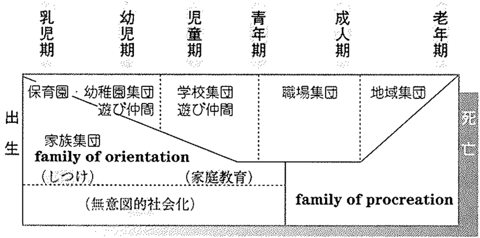
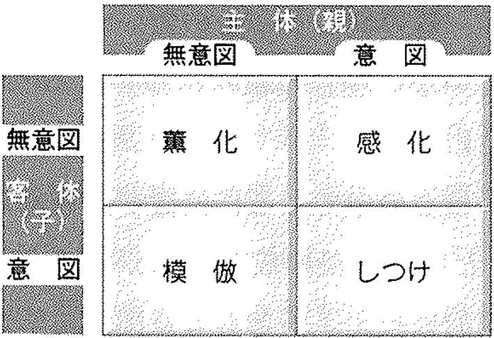
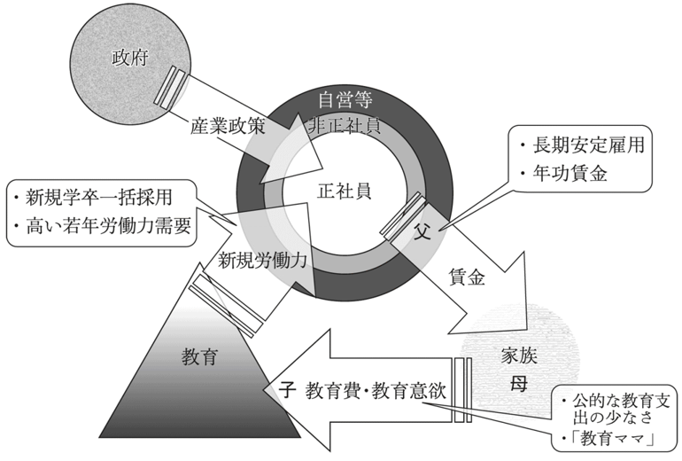

## 今日の目標

今回のテーマは、教育する家族と戦後日本社会

- 1）家族における社会化（1次・2次的社会化）の特徴と、家庭環境の格差が子どもの教育に与える影響を整理して理解する
- 2）「子ども」の発見という近代の歴史的変容と、大正期から戦後にかけて日本社会に成立・浸透した「教育する家族」の特質を説明できるようになる
- 3）「戦後日本型循環モデル」（教育・仕事・家族の強固なトライアングル）を手がかりに、高度経済成長期から現代に至る日本社会の構造的特質とそのひずみ・機能不全について議論できるようになる

## 家族と教育：イントロダクション{.scrollable}

- **身近で私的（プライベート）な空間としての家族**
  - 愛情や安らぎの拠点と捉えられがち
- **教育社会学的な視点**
  - 家族は社会から隔絶された孤島ではない
  - 社会の規範、階層格差、文化、ジェンダー意識が最初に子どもへと注入・再生産される**強力な制度的装置**
- **親の教育観としつけ**
  - 「子どもをどう育てたいか」という希望は、親個人の純粋な思いであると同時に、**その時代の社会構造や学校教育から強く規定されている**

## コメント(1)

:::{.callout-important icon="false"}
## コメント(1)
現在の社会状況で、1人の子どもを育てていくとする。あなたはその子をどんな人間にしたいか教えてください。また、そのために親として具体的に取り組むこと（例：すべて子どもの自主性に任せる、門限について厳しくしつける、小さい頃から美術館や博物館に連れて行く、など）を1つ教えてください。
:::

## 家族における社会化（1）{.scrollable}

- **社会化（Socialization）**
  - 集団生活に必要な言語、規範、生活習慣、価値観などを身につけていくプロセス
- **1次的社会化（Primary Socialization）**
  - 担い手：**家族（クーリーの提唱した「第1次集団」）**
  - 対面的・親密・情動的な全人格的関わり
  - 言語習得、感情コントロール、基本的信頼感、生活習慣など**自我の土台**を形成
- **2次的社会化（Secondary Socialization）**
  - 担い手：**学校、仲間集団、地域、メディア、職場（第2次集団）**
  - 1次的社会化を前提とし、より普遍的・専門的な知識や技能、社会的役割を学ぶ
  - 家族での社会化のあとに経験する社会化とざっくり理解すればよい

## 家族における社会化（2）{.scrollable}

- **“家庭”間格差の大きさと学校の限界**
  - 学校は出自をリセットする「平等化の装置」と標榜されてきた
  - しかし、就学前・家庭生活の背後には大きな格差が存在
    - **家族構成の違い｜** 核家族、ひとり親、きょうだいの人数
    - **経済的階層（経済資本）｜** 所得、住環境、学校外教育費（塾・習い事）
    - **文化的階層（文化資本）｜** 親の学歴、蔵書数、言葉づかい、思考様式
- **教育社会学のジレンマ**
  - 学校は家庭間格差を相殺するどころか、**「家庭環境の差を、学校内の学力や意欲の差として読み替えて再生産してしまう」**側面を持つ

## 社会化の段階とエージェント{.scrollable}

| 社会化の段階 | 主な担い手（エージェント） | 特徴・獲得されるもの |
| :--- | :--- | :--- |
| **1次的社会化** （乳幼児期〜児童期初期） | **家族（親・養育者）** | 情動的・全人格的関係。 言語、基本的信頼感、しつけ、生活習慣、自我の土台 |
| **2次的社会化** （児童期・青年期〜成人期） | **学校、仲間集団、地域、職場** | 機能的・普遍的関係。 専門知・技能、集団規範、役割行動、職業人としての態度 |

- **家族のしつけ・社会化の類型（森岡・望月 1997）**
  - 親の**「統制（ルールの厳格さ）」**と**「受容（情緒的温かさ・自主性尊重）」**の組み合わせ
  - 専制型、民主型（受容的）、放任型、無関心型など、子どもの規範意識や自立性に影響

## 「子ども」の発見（1）{.scrollable}

- **フィリップ・アリエス『〈子供〉の誕生』（1960年）**
  - 「子ども期」は普遍的な自然物ではなく、**近代に人工的に構築された歴史的産物**
- **前近代社会（近代以前）：労働力としての「小さな大人」**
  - **職住一致**：農業・林業・家内手工業など、職場と家庭が一体化
  - **身分世襲**：親の家業をそのまま継ぐ社会
  - **高い乳幼児死亡率**：生き残ること自体が不確か
  - 離乳期を過ぎると大人と同じ服を着て、社交や労働の場に参入
  - 子どもは大人と質的に異なる存在ではなく、身体が未熟な**「小さな大人」**として扱われていた

## 「子ども」の発見（2）{.scrollable}

- **近代社会における大転換**
  - 産業革命と資本主義の発展 $\rightarrow$ **職住分離**（職場と家庭の空間的分離）
  - 大人は家庭外へ給与労働に出る
  - 家庭は「労働市場から隔離された私的空間（ケアと再生産の場）」へ
- **「子ども」という特権的カテゴリーの確立**
  - 子どもは「大人の世界（過酷な労働・性・暴力）から守られ、**無垢なまま教育されるべき固有の存在**」として再定義された
- **近代学校制度との表裏一体性**
  - 労働から隔離された子どもを収容し、一斉教授・学年制で規律や知識を教え込む機関として「近代学校」が整備された

## 「教育する家族」の誕生{.scrollable}

- **広田照幸（1999）の議論**
  - 西洋近代の家族像・子ども観が日本で受容され、発展した形態
- **大正期都市新中間層（サラリーマン層）での誕生**
  - 家業や土地などの物的財産を持たないサラリーマン家庭
  - 子どもが社会的地位を継承・上昇させる唯一の手段が**「学校教育を通じた高い学歴の獲得」**に
- **家庭の合理的教育編成**
  - 「家庭生活そのものが、子どもの教育や心身の発達という目的に向けて合理的に編成される」（広田 1999）
  - 子ども部屋、学習机、知育玩具、栄養管理、規則正しい生活など、家庭全体が子どもの教育環境へと最適化された

## 「教育する家族」の2大特徴{.scrollable}

- **1. 性別役割分業を前提とした母親への教育責任の一任**
  - 父親＝「企業戦士」として外で長時間労働・家計を支える（大黒柱）
  - 母親＝専業主婦として家庭にとどまり、日々の宿題・しつけ・情操教育・受験サポートを一手に引き受けマネジメントする
- **2. 家庭のしつけ・人間形成と学校教育理念の同期化**
  - 「学校で良い成績を取り、規律を守り、進学競争で勝ち抜くこと」がそのまま家庭のしつけの至上命令に
  - 家庭が学校教育の「補完・下請け機関」として高度に一体化
- **戦後日本社会における普遍化・大衆化**
  - 高度経済成長期に雇用者比率が急増し、「サラリーマンの父親＋専業主婦の教育ママ＋2人の子ども」が日本国民全体の標準的（デフォルト）な家族モデルとして定着

## コメント(2)

:::{.callout-important icon="false"}
## コメント(2)
コメント(1)でイメージした子育て、もしくは自分自身が経験してきた保護者からの働きかけに関して、「教育する家族」の特徴のどのような点があてはまるかを1つ以上あげてみましょう。
:::

## 戦後日本型循環モデル（1）{.scrollable}

- **本田由紀（2014）の概念**
  - 高度経済成長期に確立し、戦後日本社会の驚異的な安定と繁栄を支えたシステム
- **強固な相互連動のトライアングル**
  - **「教育（学校）」「仕事（企業）」「家族」**の3領域が互いの資源を融通し合って循環

## 戦後日本型循環モデル（2）：結合構造{.scrollable}

- **1. 仕事（企業）と家族の関係**
  - **「生活給の保障」 $\leftrightarrow$ 「専業主婦による無償ケア労働」**
  - 企業は長期雇用と年功賃金（家族手当）を保障する見返りに、無限定な残業や全国転勤を要求
  - 夫の過密労働を家庭で妻が一手に支える
- **2. 家族と教育（学校）の関係**
  - **「私的教育投資」 $\leftrightarrow$ 「学歴による階層上昇」**
  - 家族は多額の教育費（塾・学費）を投じ、母親が学習を伴走
  - 学校は客観的な選抜と学歴資格を付与
- **3. 教育（学校）と仕事（企業）の関係**
  - **「同質的な労働力」 $\leftrightarrow$ 「新規学卒一括採用」**
  - 学校は規律正しく協調性の高い人材を一括して企業に送り出す

## 戦後日本型循環モデル（3）：功罪{.scrollable}

- **歴史的功績**
  - **大衆教育社会と「一億総中流」意識の実現**（高進学率・機会平等の実感）
  - **世界最低水準の若年失業率**（スムーズな学校から職業への移行）
- **内包されていた深刻な問題・ひずみ**
  - **固定的な性別役割分業**：女性のキャリア断絶（M字・L字カーブ）
  - **過熱する受験競争と「学校病理」**：詰め込み教育、いじめ、不登校、非行
  - **家庭の密室化**：過剰な親子密着、「教育虐待」、プレッシャー
  - **標準外の人々の排除**：非正規、ひとり親、低所得層の孤立・自己責任化

## 戦後日本型循環モデル（4）：対象層の限定性と機能不全{.scrollable}

- **モデルの対象層の限定性**
  - そもそも全盛期においても、このモデルが完全にあてはまる層は**大企業に勤める正規雇用男性とその家族（せいぜい2〜3割程度）**に過ぎなかった
  - 中小企業労働者や地方で暮らす人々にとってどこまであてはまったかは疑問が残る
  - しかし、ドラマに描かれる家族像や**「あるべき標準家族」の規範**として社会全体に強く機能した
- **現代における制度疲労と目詰まり**
  - 少子高齢化、低成長、雇用の非正規化、女性の有職化（共働き世帯が専業主婦世帯の2倍以上へ）
  - 前提となっていた条件が崩れ、モデルが完全に機能不全・目詰まりを起こしている（本田 2014）

## 【コラム】家族の境界線と地域の変容{.scrollable}

- **映画『ALWAYS 三丁目の夕日』（1958年頃の設定）**
  - 高度経済成長前夜の東京下町を通じて、現代家族を相対化する
- **1. 家族の境界線のあいまいさ（擬似家族と境界の流動性）**
  - 青森からの集団就職者（六子）や見ず知らずの少年（淳之介）と同居
  - 「誰が家族で誰が他人か」の境界が流動的で、生活を共にする**「機能的家族」**が自然に成立
  - 現代：住民票・戸籍・親権の厳格化による排他的な閉鎖性
- **2. 地域社会とのつながりと「公私の未分化」**
  - 茶の間の開放（テレビ鑑賞）、路地での共同子育て・見守り
  - 現代：オートロックとプライバシーの一方で**「孤育て」**や無縁化が進行
  - ケアや見守りが行政サービスや民間ビジネスへ外部化・市場化

## 【映像】『ALWAYS 三丁目の夕日』



## 家族の対比構造シート{.scrollable}

| 比較項目 | 『ALWAYS 三丁目の夕日』（昭和30年代） | 現代社会（2020年代） |
| :--- | :--- | :--- |
| **家族の境界** | **あいまいで流動的** （住み込み、擬似家族、生活実態重視） | **厳格で排他的** （戸籍・法的関係重視、核家族・単身中心） |
| **地域との関係** | **公私未分化の地縁共同体** （茶の間の開放、路地での共同子育て） | **プライバシー重視・孤立化** （オートロック、近隣との疎遠・無縁化） |
| **ケア・教育機能の所在** | **地縁・家族共同体内での相互扶助** （人情・暗黙の了解による分散） | **制度化・市場化・私事化** （行政・民間ビジネスへの委託、核家族の抱え込み） |
| **メリットとリスク** | 孤独にならない反面、過干渉や同調圧力が強い | 自由でプライバシーがある反面、孤立と自己責任化の負担が重い |

- **現代家族の「私事化（Privatization）」**
  - プライバシーを手に入れた代償として、子育てや教育の全責任を孤立した核家族で背負い込む構造

## 今日の課題

### 今回提出するもの

- コメント（Canvas LMSより提出，1〜2は回答必須、以降は任意回答）
  - **コメント(1)：** 現在の社会状況で1人の子どもを育てていくとしたらどんな人間にしたいか、親として具体的に取り組むこと
  - **コメント(2)：** 「教育する家族」の特徴のあてはまり（イメージした子育てや自身の実体験から）
