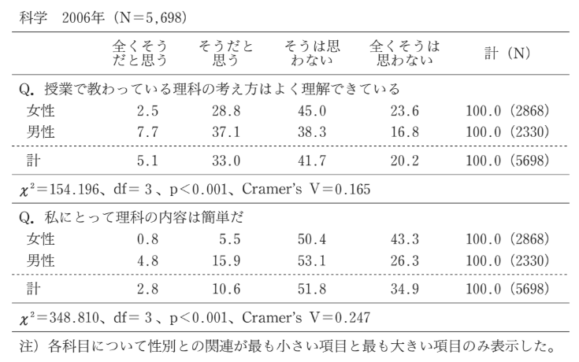
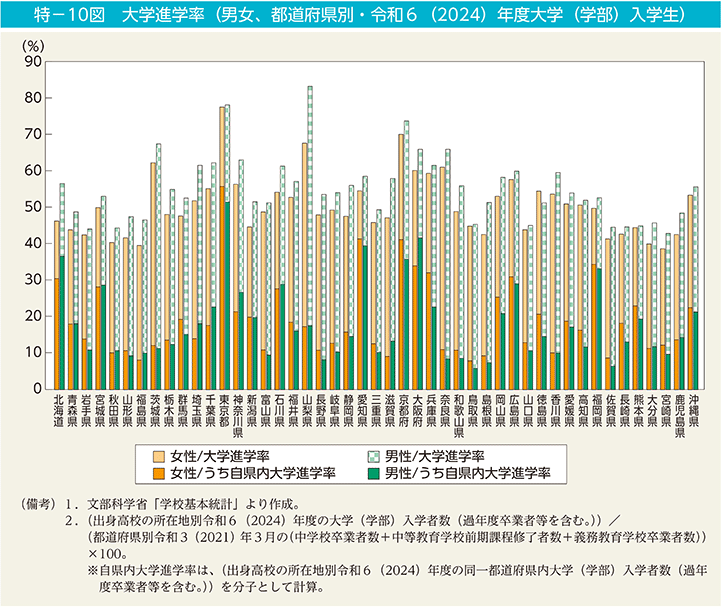
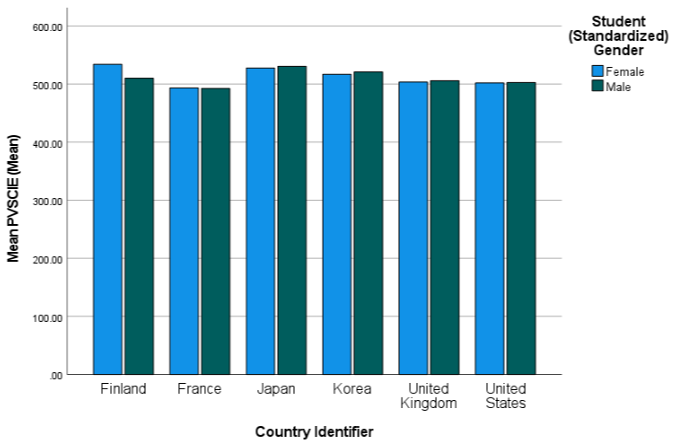
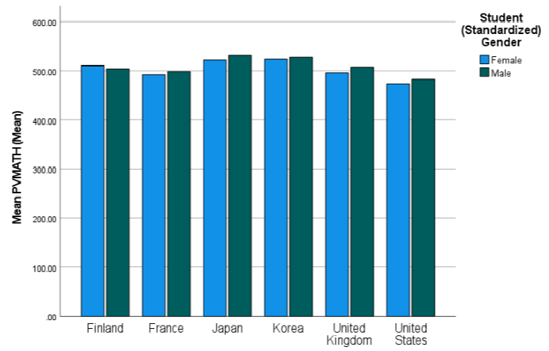
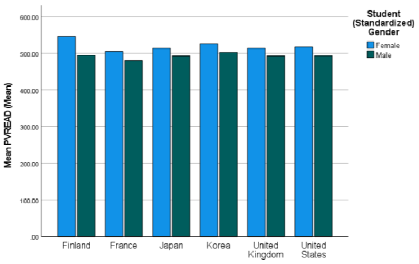
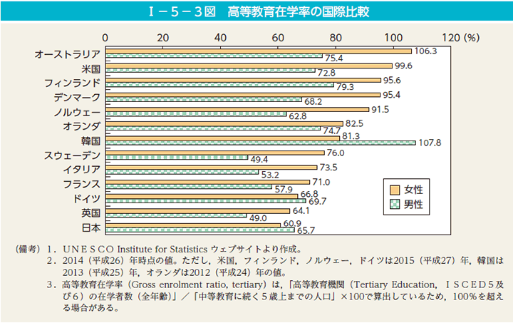
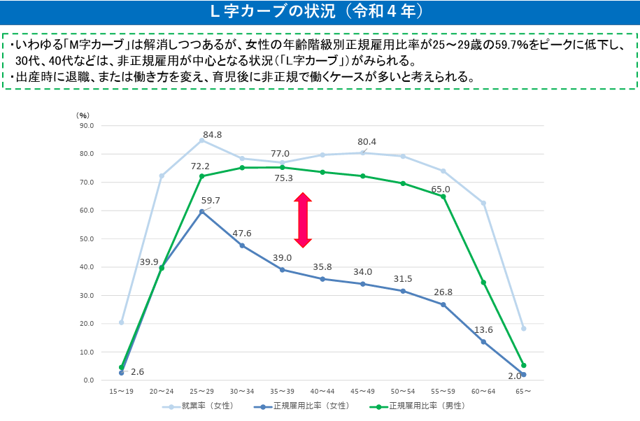

## 今日の目標

今回のテーマは、日本社会におけるジェンダーと教育

- 1）学校や家庭で生じる男女差、とくにジェンダー・イメージの形成について、具体例を用いて説明できるようになる
- 2）ジェンダーという用語ないしはテーマについて（再）認識する
- 3）教育達成における男女格差が生じるメカニズムについて、いくつかの視点から議論できる

## イントロダクション{.scrollable}

> ある腕利きの外科医が、大学病院に勤めていました。ある日、たいへんな手術を無事成功させたその医者が控室に戻ると、看護師から緊急の連絡が入りました。「先生、交通事故で大けがをした人が運ばれてきました。緊急のオペをお願いします。事故にあったのは２人で、父親と息子さんのようです。息子さんはまだ息がありますが、父親は即死だそうです・・・」「わかった、すぐ行く！」その医者は疲れた身体にムチを打ちながら、急いで処置室に向かいました。するとそこには、まだかろうじて息があるという男の子が横たえられていました。しかしその子の顔を見たとき、医者は愕然としました。なぜなら、その子はその医者の息子だったのです・・・。
（出典：http://nerino.cocolog-nifty.com/blog/2012/11/post-b08a.html）

## 無意識のジェンダーバイアス{.scrollable}

- **謎解きの答え**
  - **「その外科医は男の子の母親（女性）だった」**
  - 何ら矛盾はないが、一瞬答えに詰まる人が多い
- **混乱が生じる原因**
  - 私たちの中に**「外科医（医師）＝男性」という無意識の思い込み（アンコンシャス・ジェンダーバイアス）**がある
  - 差別する悪意がなくても、日常の経験やメディアを通じて特定の職業や役割に性別のイメージが無意識に刷り込まれている

## 男性／女性イメージの具体例{.scrollable}

- **つい「男性」を思い浮かべやすい例**
  - **企業の社長・役員・政治家｜**「リーダー」「経営陣」
  - **航空機のパイロット・電車の運転士・トラック運転手｜** 操縦・運転職
  - **ITエンジニア・研究者・大学教授｜** 理数系・学術専門職
  - **「一家の大黒柱」・家計支持者｜** 世帯主・主たる稼ぎ手
- **つい「女性」を思い浮かべやすい例**
  - **看護師・保育士・幼稚園教諭｜** ケア・お世話の役割
  - **客室乗務員（CA）・受付・秘書｜** 接客・サポート職
  - **PTA役員・学校連絡網の受取人｜** 「保護者＝母親」のデフォルト視
  - **子どもの看病・日々の家庭料理の担当者｜** 家事・育児の主担当

## コメント(1)

:::{.callout-important icon="false"}
## コメント(1)

最近、あなたが自覚した、ジェンダーに関する先入観や固定観念を教えて下さい。

- 教育に関係しないものでも大丈夫です
- 「飛行機で海外の航空会社の便に乗ったら、男性客室乗務員がいた」など、日本以外の社会との比較の観点があってもよいかもしれません

:::

## ジェンダーと学校教育・家庭教育{.scrollable}

- **ジェンダー観とジェンダー・イメージ**
  - **ジェンダー・イメージ**：「男性はxxであるべき／女性はxxが得意だ」といった、性別に付与された社会的なイメージや固定観念
  - 例：「力仕事や決断は男性の役目」「女性は料理や気配りが得意」
  - 私たちは日常生活で無意識にこうしたイメージを前提に行動・判断している
- こうした無意識の思い込みは、**学校教育や家庭教育を通じて作られている面が大きい**

## 学校における形成（1）{.scrollable}

- **教員・管理職における男女比**
  - 学校段階が上がるにつれて女性教員比率は低下
    - **小学校：62.6％**
    - **中学校：44.8％**
    - **高等学校：33.8％**
    - **大学：27.8％**（2024年度調査）
  - 校長などの管理職に占める女性比率はさらに低い
  - 子どもたちは「学校段階が上がるほど、また上位の役職ほど男性が多い」という構図を日常的に目にしながら学校生活を送る

## 学校における形成（2）{.scrollable}

- **学校生活における日常的な男女差の慣行**
  - 制度や日常的な実践を通じて性別を意識させる慣行
    - **制服**（男子＝スラックス、女子＝スカート）
    - **ランドセルの色**
    - **男女別の名簿編成**
    - **呼び方**（男子は「〜くん」、女子は「〜さん」）
  - 近年は名簿の男女混合化や制服の選択制など見直しが進むが、日常的な区分が「男らしさ／女らしさ」や性別役割の内面化を促してきた

## 学校における形成（3）{.scrollable}

- **学業・教科に対する意識のジェンダー差**
  - 客観的な学力差とは別に、教科への好意度や「自分ができる」という学業的自己効力感（自己概念）に男女差（伊佐・知念2014、古田2016）
    - **国語**：女子で好意度・自己効力感が高い
    - **算数・数学**：男子で好意度・自己効力感が高い
  - 教科イメージや自己認識の形成が、その後の**文理選択や進路形成**へとつながっていく

## 教科に対する意識に見る男女差

{width=80%}

（出所：古田2016，p.17。ただし科学と数学を比べると、数学の方が差が小さい）

## 家庭における形成{.scrollable}

- **家族や周囲の大人の接し方を通じた社会化**
  - 衣服の色やデザイン、おもちゃ（ブロック・車 vs 人形・ままごと）
  - 遊びの種類、家事手伝いの割り振り、習い事の選択
  - 声かけ（「男の子なんだから泣かない」「女の子らしくきれいに」）
- **メディアや文化装置を通じたイメージの再生産**
  - 幼児番組のタイトル（『おかあさんといっしょ』＝育児は母親？）
  - キャラクターの配置（男性＝主役・冒険者、女性＝サポート役）

## 【映像】無意識の偏見と子ども{.scrollable}

（※関連映像：BBC News Japan「大人たちの無意識の偏見が子どもに与える影響」）



## ジェンダー・イメージは問題か{.scrollable}

- **近代社会の基本理念：属性主義から業績主義への転換**
  - 性別等の「属性」ではなく、後天的な努力・能力・実績に基づく「業績主義（メリトクラシー）」を目指す（第5回以降で本格化）
  - 男女雇用機会均等法（1985）、男女共同参画社会基本法（1999）
- **ジェンダー・イメージが「スティグマ」として機能する懸念**
  - 認知的ショートカットとして役立つ面もあるが、個人の自由な選択や能力発揮を阻む「スティグマ（社会的烙印）」になりうる
  - 「女性だから理系やリーダーに向かない」「男性だから弱音を吐けない」といった心理的抑圧・自己限定

## コメント(2)：事前提示

:::{.callout-important icon="false"}
## コメント(2)：コメントを書く時間はあとでとります
今日の日本社会でも、女子が理系を選択しにくいことが問題だとされている。理工系学部への女子の進学者を増やす必要があるとしたときに、どのような取り組みが有効と考えられるかを考えてみてください。そのあと、そもそもそのような取り組みが必要でないと考える場合は、その点についても説明してみてください。
:::

## ジェンダーと教育達成の格差{.scrollable}

- **教育達成（Educational Attainment）**
  - ここでは主に現代日本の代表的指標である**「（四年制）大学進学率」**を取り上げる
- **首都圏出身者と全国の状況のギャップ**
  - 立教大生（首都圏・関東出身）は「周囲の友人たちも男女問わず大学へ行くのが当たり前で、男女差を感じたことがない」と感じがち
  - しかし全国に視野を広げると、**都道府県によって進学率水準も、男女差の出方も大きく異なる**

## 都道府県別にみた大学進学率{.scrollable}

{width=75%}

（出所：男女共同参画局（2025）、https://www.gender.go.jp/about_danjo/whitepaper/r07/zentai/html/zuhyo/zuhyo00-10.html）

- 地域によって男女差の大きさに違いがある
- **女子が男子を上回っている都道府県は一つも見られない**

## 学力の男女差（PISA調査）{.scrollable}

- 男子の方が明らかに学力が高いために大学進学率が高いのか？
- PISA調査による主要6か国の学力スコア比較：

::: {layout-ncol=3}

:::

- 科学・数学の男女差はごくわずか
- **読解力は6か国すべてで女子が男子より高い**
- 学力差が大学進学率の格差を直接説明するわけではない

## 高等教育在学率の国際比較{.scrollable}

日本でみられるような**進学における男性の優位性は、先進国の中では珍しい（例外的）**

{width=75%}

（出所：男女共同参画局（2025）、https://www.gender.go.jp/about_danjo/whitepaper/h29/zentai/html/zuhyo/zuhyo01-05-03.html）

## なぜ教育達成の男女差が生まれるか（1）{.scrollable}

- **入試制度・選抜選考における制度的扱い**
  - **医学部不正入試問題**：女子受験生への一律減点・合格抑制
    - 医師という学歴と職業が直結した分野での特殊性（第5回以降に関連）
  - **東京都立高校の男女別定員制**：女子の合格最低点が高くなっていた問題
    - 倍率による仕組みだが、男子の最低点が高ければより早く是正された可能性
- **卒業後の労働市場・ライフコースからの逆規定**
  - 総合職・正規雇用の「男性モデル」（長時間労働・転勤）
  - キャリア中断・非正規化しやすい「女性モデル」（M字／L字カーブ）
  - 「女性が四大を出ても報われないのでは」という予期が進学行動を抑制

## 労働市場の構造：L字カーブ{.scrollable}

{width=85%}

（出所：男女共同参画局（2023）、「Ｌ字カーブの解消に向けて①」）

## なぜ教育達成の男女差が生まれるか（2）{.scrollable}

- **家庭や親における進学期待・教育投資の格差**
  - 男子：浪人や県外・首都圏への一人暮らしを許容してでも難関四大へ
  - 女子：現役合格、自宅通学、短大・医療系専門学校を推奨
  - 世帯内の資源配分バイアス（寺町2022）が地方の男女格差に直結
- **幼少期からの社会化と自己概念の形成**
  - 「理数系＝男子、文系・ケア系＝女子」のステレオタイプ
  - ジェンダー化された期待に囲まれる中での無意識の**自己選別**

## コメント(2)：回答時間

:::{.callout-important icon="false"}
## コメント(2)：再掲
今日の日本社会でも、女子が理系を選択しにくいことが問題だとされている。理工系学部への女子の進学者を増やす必要があるとしたときに、どのような取り組みが有効と考えられるかを考えてみてください。そのあと、そもそもそのような取り組みが必要でないと考える場合は、その点についても説明してみてください。
:::

## 今日の課題

### 今回提出するもの

- コメント（Canvas LMSより提出，1～2は回答必須、以降は任意回答）

